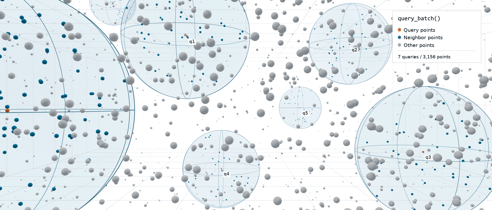

[](LICENSE) [](https://en.cppreference.com/w/cpp/14) [](https://github.com/FelixFrenchFry/cellmate/actions/workflows/tests.yml)

# cellmate::NeighborSearch 🔎

Efficient fixed-radius neighbor search in 3D point clouds, dense or sparse, header-only for C++14 and later.



The class `cellmate::NeighborSearch` finds every point within a radius of a query position and returns their indices. Under the hood, cellmate is a compact cell-linked list (CLL) in Morton order [Mor66], related to the CLL variant by Band et al. [BGT20] and the compact hashing it builds on [IABT11]. While the CLL has to be rebuilt whenever points move, rebuilds are extremely cheap, and queries read contiguous memory. Together, this optimizes for high query speed across a wide variety of point counts, densities and geometries.

* **Time** - rebuilds take O(N) time for N points, using a radix sort on the Morton keys and a single pass to build the cells. A query costs O(log C + M) for C occupied cells and M candidate points in its surrounding cells, which is O(M) in practice thanks to a cell prefix directory and lookup cache. In comparison, tree-based data structures like k-d trees and octrees typically take O(N log N) to build and O(log N + M) per query.
* **Memory** - the compact data structure uses O(N) memory for N points, since only occupied cells are stored, independent of the size of the domain. Sparse or clustered point clouds therefore cost no more memory than a dense distribution of points.
* **Parallelism** - the rebuild and batch query pipelines are heavily parallelized using OpenMP directives. Additionally, each function has a sequential fallback version for builds without OpenMP or when this execution mode is specified.
* **Vectorization** - distance checks, cell keys, candidate gathering, ... and other hot loops are vectorized using SIMD with AVX2 or AVX-512 intrinsics, selected at compile time. Additionally, each operation has a scalar fallback version with bit-identical results for CPUs or builds without these instruction sets.

## How to use

The example below indexes a vector of a custom particle struct, then finds all neighbors within a radius of 1.0 for one position and for every particle, including the particle itself:

```cpp
#include <cellmate/neighbor_search.hpp>

#include <cstdint>
#include <iostream>
#include <vector>

struct Particle { float x, y, z; float mass; };

int main()
{
    std::vector<Particle> particles = { { 0, 0, 0, 1 }, { 0.5f, 0, 0, 1 }, { 3, 0, 0, 1 } };

    // init with fixed search radius
    cellmate::NeighborSearch search(1.0f);

    // rebuild whenever the points move
    search.rebuild(&particles[0].x, particles.size(), sizeof(Particle));

    // one query: indices of all points within the radius
    std::vector<std::uint32_t> neighbors;
    search.query({ 0, 0, 0 }, neighbors);

    // many queries: all indices in one vector, from offsets[i] to offsets[i + 1] for query i
    std::vector<std::size_t> offsets;
    search.query_batch(&particles[0].x, particles.size(), sizeof(Particle), neighbors, offsets);

    for (std::size_t i = 0; i < particles.size(); i++)
    {
        // prints neighbor counts { 2, 2, 1 }
        std::cout << i << ": " << offsets[i + 1] - offsets[i] << " neighbors\n";
    }
}
```

## Settings

These constructor and function calls use default settings that fit most cases, but can optionally be overridden with alternatives:

| Setting | Passed to | Default | Alternative |
|---|---|---|---|
| `PointAccess::` | `NeighborSearch()` | `cpy` makes an internal Morton-ordered copy of the positions to allow for more efficient distance checks | `ref` saves the 12 bytes per point copy by reading the positions in place, at the cost of scattered reads in queries (positions **must** stay alive and unchanged until the next rebuild) |
| `ComputeMode::` | `rebuild()`, `query_batch()` | `par` uses the parallelized version (if OpenMP enabled and input large enough) | `seq` uses the sequential version on the calling thread |
| `QueryOrder::` | `query_batch()` | `morton` processes the queries in Morton order for more efficient traversal | `input` processes the queries in the supplied order (good if they already have spatial locality) |

## References

* [BGT20] S. Band, C. Gissler and M. Teschner, 2020. "Compressed Neighbour Lists for SPH", Computer Graphics Forum 39, 1, 531-542.
* [IABT11] M. Ihmsen, N. Akinci, M. Becker and M. Teschner, 2011. "A Parallel SPH Implementation on Multi-Core CPUs", Computer Graphics Forum 30, 1, 99-112.
* [Mor66] G. M. Morton, 1966. "A Computer Oriented Geodetic Data Base and a New Technique in File Sequencing", Technical report, IBM Ltd., Ottawa.
