[](LICENSE) [](https://en.cppreference.com/w/cpp/14) [](https://github.com/FelixFrenchFry/cellmate/actions/workflows/tests.yml)

# cellmate::NeighborSearch 🔎

Efficient fixed-radius neighbor search in 3D point clouds, dense or sparse, header-only for C++14 and later.

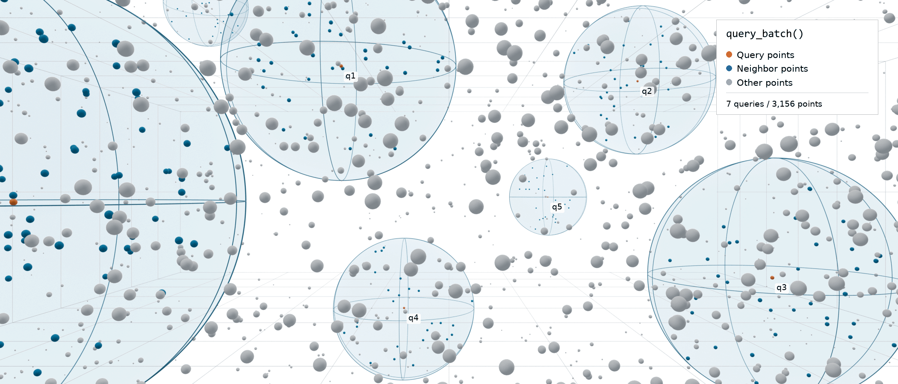

The class `cellmate::NeighborSearch` finds every point within a radius of a query position and returns their indices. Under the hood, cellmate is a compact cell-linked list (CLL) in Morton order [Mor66], related to the CLL variant by Band et al. [BGT20] and the compact hashing it builds on [IABT11]. While the CLL has to be rebuilt whenever points move, rebuilds are extremely cheap, and queries read contiguous memory. Together, this optimizes for high query speed across a wide variety of point counts, densities and geometries.

* **Time** - rebuilds take O(N) time for N points, using a radix sort on the Morton keys and a single pass to build the cells. A query costs O(log C + M) for C occupied cells and M candidate points in its surrounding cells, which is O(M) in practice thanks to a cell prefix directory and lookup cache. In comparison, tree-based data structures like k-d trees and octrees typically take O(N log N) to build and O(log N + M) per query.
* **Memory** - the compact data structure uses O(N) memory for N points, since only occupied cells are stored, independent of the size of the domain. Sparse or clustered point clouds therefore cost no more memory than a dense distribution of points.
* **Parallelism** - the rebuild and batch query pipelines are heavily parallelized using OpenMP directives. Additionally, each function has a sequential fallback version for builds without OpenMP or when this execution mode is specified.
* **Vectorization** - distance checks, cell keys, candidate gathering, ... and other hot loops are vectorized using SIMD with AVX2 or AVX-512 or NEON64 intrinsics, selected at compile time. `AUTO` is the default, and you can select `SCALAR`, `NEON64`, `AVX256`, or `AVX512` explicitly. Additionally, each operation has a scalar fallback version with bit-identical results for CPUs or builds without these instruction sets.

## Usage

The example below indexes a vector of a custom particle struct, then finds all neighbors within a radius of 1.0 for one position and for every particle, including the particle itself:

```cpp
#include <cellmate/neighbor_search.hpp>

#include <cstdint>
#include <iostream>
#include <vector>

struct Particle { float x, y, z; float mass; };

int main()
{
    std::vector<Particle> particles = { { 0, 0, 0, 1 }, { 0.5f, 0, 0, 1 }, { 3, 0, 0, 1 } };

    // init with fixed search radius
    cellmate::NeighborSearch search(1.0f);

    // rebuild whenever the points move
    search.rebuild(&particles[0].x, particles.size(), sizeof(Particle));

    // one query: indices of all points within the radius
    std::vector<std::uint32_t> neighbors;
    search.query({ 0, 0, 0 }, neighbors);

    // many queries: all indices in one vector, from offsets[i] to offsets[i + 1] for query i
    std::vector<std::size_t> offsets;
    search.query_batch(&particles[0].x, particles.size(), sizeof(Particle), neighbors, offsets);

    for (std::size_t i = 0; i < particles.size(); i++)
    {
        // prints neighbor counts { 2, 2, 1 }
        std::cout << i << ": " << offsets[i + 1] - offsets[i] << " neighbors\n";
    }
}
```

## Settings

These constructor and function calls use default settings that fit most cases, but can optionally be overridden with alternatives:

| Setting | Passed to | Default | Alternative |
|---|---|---|---|
| `PointAccess::` | `NeighborSearch()` | `cpy` makes an internal Morton-ordered copy of the positions to allow for more efficient distance checks | `ref` saves the 12 bytes per point copy by reading the positions in place, at the cost of scattered reads in queries (positions **must** stay alive and unchanged until the next rebuild) |
| `ComputeMode::` | `rebuild()`, `query_batch()` | `par` uses the parallelized version (if OpenMP enabled and input large enough) | `seq` uses the sequential version on the calling thread |
| `QueryOrder::` | `query_batch()` | `morton` processes the queries in Morton order for more efficient traversal | `input` processes the queries in the supplied order (good if they already have spatial locality) |

## Benchmarks

Google Benchmark suites measure rebuilds, single queries and batch queries across point counts, densities and distributions (uniform, clustered, anisotropic, lattice and spherical surfaces), with serial and parallel variants. A separate suite compares cellmate with eight external libraries.

- [TreeNSearch](https://github.com/InteractiveComputerGraphics/TreeNSearch)
- [CompactNSearch](https://github.com/InteractiveComputerGraphics/CompactNSearch)
- [nanoflann](https://github.com/jlblancoc/nanoflann)
- [PicoTree](https://github.com/Jaybro/pico_tree)
- [jbehley/octree](https://github.com/jbehley/octree)
- [Boost.Geometry R-tree](https://www.boost.org/doc/libs/latest/libs/geometry/doc/html/geometry/spatial_indexes/introduction.html)
- [CGAL](https://doc.cgal.org/latest/Spatial_searching/index.html)
- [Ponca](https://github.com/poncateam/ponca)

It uses the same workloads and checks sampled neighbor lists against brute force. The plots use measurements from commit `6ba6a89547f7`. Timing plots show the mean of three repetitions. Bar whiskers extend one sample standard deviation on either side. Output layout and handling of self matches vary by adapter.

### Serial

The serial comparison runs the operations on a single thread. Across four point distributions, the plots time index rebuilds, batch queries on an existing index, and a full index rebuild followed by batch queries.

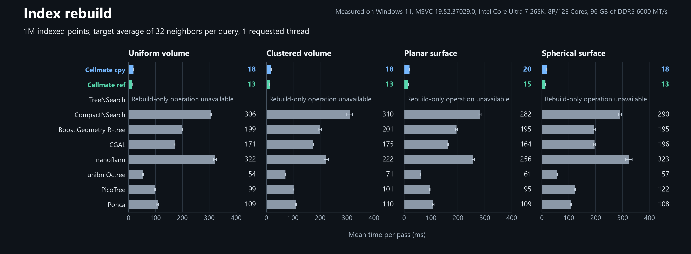

<!-- BEGIN BENCHMARK MEASUREMENTS -->
<details>
<summary>Measurements (40 rows)</summary>

Measured on Windows 11, MSVC 19.52.37029.0, Intel Core Ultra 7 265K, 8P/12E Cores, 96 GB of DDR5 6000 MT/s  
1M indexed points, target average of 32 neighbors per query, 1 requested thread

| Scenario | Library | Mean (ms) | Stddev (ms) | Status | Note |
| --- | --- | ---: | ---: | --- | --- |
| Uniform volume | cellmate `cpy` | 18.22 | 0.29 | OK |  |
| Uniform volume | cellmate `ref` | 13.09 | 0.23 | OK |  |
| Uniform volume | TreeNSearch |  |  | Unsupported | Rebuild-only operation unavailable |
| Uniform volume | CompactNSearch | 305.95 | 2.73 | OK |  |
| Uniform volume | Boost.Geometry R-tree | 199.19 | 0.60 | OK |  |
| Uniform volume | CGAL | 171.00 | 1.69 | OK |  |
| Uniform volume | nanoflann | 321.79 | 5.38 | OK |  |
| Uniform volume | unibn Octree | 54.22 | 1.23 | OK |  |
| Uniform volume | PicoTree | 99.16 | 1.18 | OK |  |
| Uniform volume | Ponca | 108.64 | 3.58 | OK |  |
| Clustered volume | cellmate `cpy` | 17.68 | 0.56 | OK |  |
| Clustered volume | cellmate `ref` | 12.79 | 0.46 | OK |  |
| Clustered volume | TreeNSearch |  |  | Unsupported | Rebuild-only operation unavailable |
| Clustered volume | CompactNSearch | 309.79 | 10.98 | OK |  |
| Clustered volume | Boost.Geometry R-tree | 200.56 | 5.36 | OK |  |
| Clustered volume | CGAL | 174.83 | 0.90 | OK |  |
| Clustered volume | nanoflann | 222.03 | 8.12 | OK |  |
| Clustered volume | unibn Octree | 71.05 | 1.64 | OK |  |
| Clustered volume | PicoTree | 101.06 | 1.66 | OK |  |
| Clustered volume | Ponca | 109.84 | 2.02 | OK |  |
| Planar surface | cellmate `cpy` | 19.76 | 0.24 | OK |  |
| Planar surface | cellmate `ref` | 15.32 | 1.00 | OK |  |
| Planar surface | TreeNSearch |  |  | Unsupported | Rebuild-only operation unavailable |
| Planar surface | CompactNSearch | 282.09 | 3.80 | OK |  |
| Planar surface | Boost.Geometry R-tree | 194.73 | 3.42 | OK |  |
| Planar surface | CGAL | 163.91 | 1.60 | OK |  |
| Planar surface | nanoflann | 256.50 | 4.13 | OK |  |
| Planar surface | unibn Octree | 61.12 | 0.71 | OK |  |
| Planar surface | PicoTree | 95.48 | 0.72 | OK |  |
| Planar surface | Ponca | 108.63 | 2.78 | OK |  |
| Spherical surface | cellmate `cpy` | 18.07 | 0.59 | OK |  |
| Spherical surface | cellmate `ref` | 12.84 | 0.61 | OK |  |
| Spherical surface | TreeNSearch |  |  | Unsupported | Rebuild-only operation unavailable |
| Spherical surface | CompactNSearch | 290.34 | 5.54 | OK |  |
| Spherical surface | Boost.Geometry R-tree | 194.85 | 4.87 | OK |  |
| Spherical surface | CGAL | 195.78 | 3.85 | OK |  |
| Spherical surface | nanoflann | 323.30 | 11.94 | OK |  |
| Spherical surface | unibn Octree | 56.72 | 0.79 | OK |  |
| Spherical surface | PicoTree | 121.98 | 1.90 | OK |  |
| Spherical surface | Ponca | 107.61 | 2.48 | OK |  |

</details>
<!-- END BENCHMARK MEASUREMENTS -->

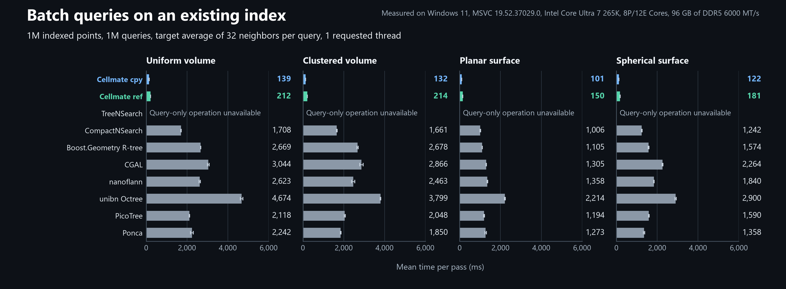

<!-- BEGIN BENCHMARK MEASUREMENTS -->
<details>
<summary>Measurements (40 rows)</summary>

Measured on Windows 11, MSVC 19.52.37029.0, Intel Core Ultra 7 265K, 8P/12E Cores, 96 GB of DDR5 6000 MT/s  
1M indexed points, 1M queries, target average of 32 neighbors per query, 1 requested thread

| Scenario | Library | Mean (ms) | Stddev (ms) | Status | Note |
| --- | --- | ---: | ---: | --- | --- |
| Uniform volume | cellmate `cpy` | 139.29 | 8.60 | OK |  |
| Uniform volume | cellmate `ref` | 211.55 | 0.50 | OK |  |
| Uniform volume | TreeNSearch |  |  | Unsupported | Query-only operation unavailable |
| Uniform volume | CompactNSearch | 1708.19 | 11.24 | OK |  |
| Uniform volume | Boost.Geometry R-tree | 2669.16 | 9.42 | OK |  |
| Uniform volume | CGAL | 3043.76 | 39.93 | OK |  |
| Uniform volume | nanoflann | 2622.74 | 28.50 | OK |  |
| Uniform volume | unibn Octree | 4673.50 | 66.40 | OK |  |
| Uniform volume | PicoTree | 2117.68 | 10.02 | OK |  |
| Uniform volume | Ponca | 2241.53 | 66.27 | OK |  |
| Clustered volume | cellmate `cpy` | 131.81 | 0.49 | OK |  |
| Clustered volume | cellmate `ref` | 213.51 | 1.63 | OK |  |
| Clustered volume | TreeNSearch |  |  | Unsupported | Query-only operation unavailable |
| Clustered volume | CompactNSearch | 1661.00 | 12.75 | OK |  |
| Clustered volume | Boost.Geometry R-tree | 2678.46 | 30.42 | OK |  |
| Clustered volume | CGAL | 2865.77 | 83.39 | OK |  |
| Clustered volume | nanoflann | 2462.52 | 77.26 | OK |  |
| Clustered volume | unibn Octree | 3798.54 | 14.93 | OK |  |
| Clustered volume | PicoTree | 2048.25 | 27.20 | OK |  |
| Clustered volume | Ponca | 1849.62 | 18.45 | OK |  |
| Planar surface | cellmate `cpy` | 101.49 | 2.14 | OK |  |
| Planar surface | cellmate `ref` | 149.94 | 2.90 | OK |  |
| Planar surface | TreeNSearch |  |  | Unsupported | Query-only operation unavailable |
| Planar surface | CompactNSearch | 1006.36 | 16.05 | OK |  |
| Planar surface | Boost.Geometry R-tree | 1104.52 | 6.37 | OK |  |
| Planar surface | CGAL | 1304.55 | 10.92 | OK |  |
| Planar surface | nanoflann | 1358.42 | 15.87 | OK |  |
| Planar surface | unibn Octree | 2214.03 | 23.77 | OK |  |
| Planar surface | PicoTree | 1194.28 | 22.03 | OK |  |
| Planar surface | Ponca | 1273.06 | 33.34 | OK |  |
| Spherical surface | cellmate `cpy` | 122.34 | 2.81 | OK |  |
| Spherical surface | cellmate `ref` | 181.18 | 2.48 | OK |  |
| Spherical surface | TreeNSearch |  |  | Unsupported | Query-only operation unavailable |
| Spherical surface | CompactNSearch | 1242.45 | 13.07 | OK |  |
| Spherical surface | Boost.Geometry R-tree | 1574.04 | 19.02 | OK |  |
| Spherical surface | CGAL | 2264.31 | 21.84 | OK |  |
| Spherical surface | nanoflann | 1839.65 | 8.22 | OK |  |
| Spherical surface | unibn Octree | 2900.44 | 33.44 | OK |  |
| Spherical surface | PicoTree | 1589.87 | 12.73 | OK |  |
| Spherical surface | Ponca | 1357.63 | 31.71 | OK |  |

</details>
<!-- END BENCHMARK MEASUREMENTS -->

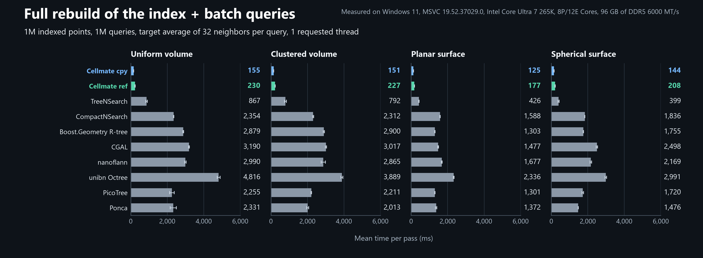

<!-- BEGIN BENCHMARK MEASUREMENTS -->
<details>
<summary>Measurements (40 rows)</summary>

Measured on Windows 11, MSVC 19.52.37029.0, Intel Core Ultra 7 265K, 8P/12E Cores, 96 GB of DDR5 6000 MT/s  
1M indexed points, 1M queries, target average of 32 neighbors per query, 1 requested thread

| Scenario | Library | Mean (ms) | Stddev (ms) | Status | Note |
| --- | --- | ---: | ---: | --- | --- |
| Uniform volume | cellmate `cpy` | 155.20 | 6.38 | OK |  |
| Uniform volume | cellmate `ref` | 230.38 | 10.30 | OK |  |
| Uniform volume | TreeNSearch | 866.51 | 43.97 | OK |  |
| Uniform volume | CompactNSearch | 2354.06 | 10.49 | OK |  |
| Uniform volume | Boost.Geometry R-tree | 2878.83 | 20.16 | OK |  |
| Uniform volume | CGAL | 3189.78 | 21.88 | OK |  |
| Uniform volume | nanoflann | 2990.22 | 46.33 | OK |  |
| Uniform volume | unibn Octree | 4815.65 | 82.54 | OK |  |
| Uniform volume | PicoTree | 2255.21 | 130.12 | OK |  |
| Uniform volume | Ponca | 2330.53 | 169.94 | OK |  |
| Clustered volume | cellmate `cpy` | 151.05 | 5.77 | OK |  |
| Clustered volume | cellmate `ref` | 227.29 | 5.10 | OK |  |
| Clustered volume | TreeNSearch | 792.38 | 56.58 | OK |  |
| Clustered volume | CompactNSearch | 2311.86 | 24.09 | OK |  |
| Clustered volume | Boost.Geometry R-tree | 2899.52 | 28.54 | OK |  |
| Clustered volume | CGAL | 3017.22 | 32.40 | OK |  |
| Clustered volume | nanoflann | 2865.40 | 115.62 | OK |  |
| Clustered volume | unibn Octree | 3889.49 | 55.06 | OK |  |
| Clustered volume | PicoTree | 2211.23 | 16.13 | OK |  |
| Clustered volume | Ponca | 2013.47 | 50.39 | OK |  |
| Planar surface | cellmate `cpy` | 124.70 | 3.89 | OK |  |
| Planar surface | cellmate `ref` | 176.76 | 5.06 | OK |  |
| Planar surface | TreeNSearch | 426.17 | 10.63 | OK |  |
| Planar surface | CompactNSearch | 1587.55 | 9.69 | OK |  |
| Planar surface | Boost.Geometry R-tree | 1302.66 | 10.57 | OK |  |
| Planar surface | CGAL | 1476.72 | 22.53 | OK |  |
| Planar surface | nanoflann | 1677.24 | 19.28 | OK |  |
| Planar surface | unibn Octree | 2335.57 | 20.44 | OK |  |
| Planar surface | PicoTree | 1300.73 | 10.37 | OK |  |
| Planar surface | Ponca | 1372.07 | 36.95 | OK |  |
| Spherical surface | cellmate `cpy` | 144.23 | 9.86 | OK |  |
| Spherical surface | cellmate `ref` | 208.09 | 6.55 | OK |  |
| Spherical surface | TreeNSearch | 398.89 | 28.67 | OK |  |
| Spherical surface | CompactNSearch | 1835.64 | 3.42 | OK |  |
| Spherical surface | Boost.Geometry R-tree | 1755.19 | 6.82 | OK |  |
| Spherical surface | CGAL | 2497.97 | 38.76 | OK |  |
| Spherical surface | nanoflann | 2169.37 | 41.57 | OK |  |
| Spherical surface | unibn Octree | 2990.55 | 42.25 | OK |  |
| Spherical surface | PicoTree | 1720.35 | 40.85 | OK |  |
| Spherical surface | Ponca | 1476.04 | 6.22 | OK |  |

</details>
<!-- END BENCHMARK MEASUREMENTS -->

### Parallel

The parallel comparison runs the operations on 8 requested threads. Across four point distributions, the plots time index rebuilds, batch queries on an existing index, and a full index rebuild followed by batch queries.

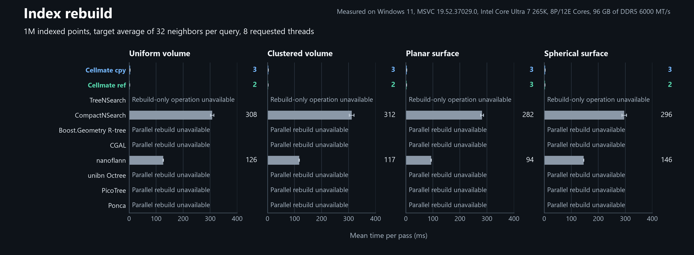

<!-- BEGIN BENCHMARK MEASUREMENTS -->
<details>
<summary>Measurements (40 rows)</summary>

Measured on Windows 11, MSVC 19.52.37029.0, Intel Core Ultra 7 265K, 8P/12E Cores, 96 GB of DDR5 6000 MT/s  
1M indexed points, target average of 32 neighbors per query, 8 requested threads

| Scenario | Library | Mean (ms) | Stddev (ms) | Status | Note |
| --- | --- | ---: | ---: | --- | --- |
| Uniform volume | cellmate `cpy` | 3.39 | 0.15 | OK |  |
| Uniform volume | cellmate `ref` | 2.29 | 0.02 | OK |  |
| Uniform volume | TreeNSearch |  |  | Unsupported | Rebuild-only operation unavailable |
| Uniform volume | CompactNSearch | 307.53 | 6.20 | OK |  |
| Uniform volume | Boost.Geometry R-tree |  |  | Unsupported | Parallel rebuild unavailable |
| Uniform volume | CGAL |  |  | Unsupported | Parallel rebuild unavailable |
| Uniform volume | nanoflann | 126.44 | 0.45 | OK |  |
| Uniform volume | unibn Octree |  |  | Unsupported | Parallel rebuild unavailable |
| Uniform volume | PicoTree |  |  | Unsupported | Parallel rebuild unavailable |
| Uniform volume | Ponca |  |  | Unsupported | Parallel rebuild unavailable |
| Clustered volume | cellmate `cpy` | 3.16 | 0.04 | OK |  |
| Clustered volume | cellmate `ref` | 2.30 | 0.05 | OK |  |
| Clustered volume | TreeNSearch |  |  | Unsupported | Rebuild-only operation unavailable |
| Clustered volume | CompactNSearch | 311.53 | 8.83 | OK |  |
| Clustered volume | Boost.Geometry R-tree |  |  | Unsupported | Parallel rebuild unavailable |
| Clustered volume | CGAL |  |  | Unsupported | Parallel rebuild unavailable |
| Clustered volume | nanoflann | 117.20 | 0.78 | OK |  |
| Clustered volume | unibn Octree |  |  | Unsupported | Parallel rebuild unavailable |
| Clustered volume | PicoTree |  |  | Unsupported | Parallel rebuild unavailable |
| Clustered volume | Ponca |  |  | Unsupported | Parallel rebuild unavailable |
| Planar surface | cellmate `cpy` | 3.40 | 0.02 | OK |  |
| Planar surface | cellmate `ref` | 2.62 | 0.02 | OK |  |
| Planar surface | TreeNSearch |  |  | Unsupported | Rebuild-only operation unavailable |
| Planar surface | CompactNSearch | 281.98 | 5.31 | OK |  |
| Planar surface | Boost.Geometry R-tree |  |  | Unsupported | Parallel rebuild unavailable |
| Planar surface | CGAL |  |  | Unsupported | Parallel rebuild unavailable |
| Planar surface | nanoflann | 93.80 | 0.44 | OK |  |
| Planar surface | unibn Octree |  |  | Unsupported | Parallel rebuild unavailable |
| Planar surface | PicoTree |  |  | Unsupported | Parallel rebuild unavailable |
| Planar surface | Ponca |  |  | Unsupported | Parallel rebuild unavailable |
| Spherical surface | cellmate `cpy` | 3.14 | 0.04 | OK |  |
| Spherical surface | cellmate `ref` | 2.41 | 0.03 | OK |  |
| Spherical surface | TreeNSearch |  |  | Unsupported | Rebuild-only operation unavailable |
| Spherical surface | CompactNSearch | 295.71 | 8.37 | OK |  |
| Spherical surface | Boost.Geometry R-tree |  |  | Unsupported | Parallel rebuild unavailable |
| Spherical surface | CGAL |  |  | Unsupported | Parallel rebuild unavailable |
| Spherical surface | nanoflann | 146.02 | 0.46 | OK |  |
| Spherical surface | unibn Octree |  |  | Unsupported | Parallel rebuild unavailable |
| Spherical surface | PicoTree |  |  | Unsupported | Parallel rebuild unavailable |
| Spherical surface | Ponca |  |  | Unsupported | Parallel rebuild unavailable |

</details>
<!-- END BENCHMARK MEASUREMENTS -->

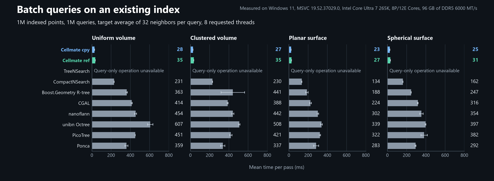

<!-- BEGIN BENCHMARK MEASUREMENTS -->
<details>
<summary>Measurements (40 rows)</summary>

Measured on Windows 11, MSVC 19.52.37029.0, Intel Core Ultra 7 265K, 8P/12E Cores, 96 GB of DDR5 6000 MT/s  
1M indexed points, 1M queries, target average of 32 neighbors per query, 8 requested threads

| Scenario | Library | Mean (ms) | Stddev (ms) | Status | Note |
| --- | --- | ---: | ---: | --- | --- |
| Uniform volume | cellmate `cpy` | 27.52 | 0.39 | OK |  |
| Uniform volume | cellmate `ref` | 35.04 | 0.23 | OK |  |
| Uniform volume | TreeNSearch |  |  | Unsupported | Query-only operation unavailable |
| Uniform volume | CompactNSearch | 231.08 | 1.28 | OK |  |
| Uniform volume | Boost.Geometry R-tree | 362.51 | 7.16 | OK |  |
| Uniform volume | CGAL | 414.48 | 5.91 | OK |  |
| Uniform volume | nanoflann | 454.39 | 10.01 | OK |  |
| Uniform volume | unibn Octree | 606.71 | 28.19 | OK |  |
| Uniform volume | PicoTree | 450.70 | 0.24 | OK |  |
| Uniform volume | Ponca | 359.05 | 15.41 | OK |  |
| Clustered volume | cellmate `cpy` | 27.19 | 0.17 | OK |  |
| Clustered volume | cellmate `ref` | 35.35 | 0.29 | OK |  |
| Clustered volume | TreeNSearch |  |  | Unsupported | Query-only operation unavailable |
| Clustered volume | CompactNSearch | 229.75 | 1.40 | OK |  |
| Clustered volume | Boost.Geometry R-tree | 440.99 | 121.86 | OK |  |
| Clustered volume | CGAL | 387.59 | 4.85 | OK |  |
| Clustered volume | nanoflann | 441.51 | 10.96 | OK |  |
| Clustered volume | unibn Octree | 507.87 | 7.13 | OK |  |
| Clustered volume | PicoTree | 420.76 | 11.44 | OK |  |
| Clustered volume | Ponca | 336.84 | 22.20 | OK |  |
| Planar surface | cellmate `cpy` | 22.98 | 0.08 | OK |  |
| Planar surface | cellmate `ref` | 26.97 | 0.11 | OK |  |
| Planar surface | TreeNSearch |  |  | Unsupported | Query-only operation unavailable |
| Planar surface | CompactNSearch | 133.69 | 1.18 | OK |  |
| Planar surface | Boost.Geometry R-tree | 187.81 | 12.88 | OK |  |
| Planar surface | CGAL | 224.28 | 9.24 | OK |  |
| Planar surface | nanoflann | 301.51 | 7.52 | OK |  |
| Planar surface | unibn Octree | 338.64 | 9.30 | OK |  |
| Planar surface | PicoTree | 322.40 | 6.23 | OK |  |
| Planar surface | Ponca | 283.16 | 26.48 | OK |  |
| Spherical surface | cellmate `cpy` | 25.29 | 0.37 | OK |  |
| Spherical surface | cellmate `ref` | 30.87 | 1.33 | OK |  |
| Spherical surface | TreeNSearch |  |  | Unsupported | Query-only operation unavailable |
| Spherical surface | CompactNSearch | 161.55 | 0.39 | OK |  |
| Spherical surface | Boost.Geometry R-tree | 246.79 | 0.96 | OK |  |
| Spherical surface | CGAL | 316.13 | 3.55 | OK |  |
| Spherical surface | nanoflann | 353.86 | 18.01 | OK |  |
| Spherical surface | unibn Octree | 397.11 | 4.23 | OK |  |
| Spherical surface | PicoTree | 381.70 | 33.12 | OK |  |
| Spherical surface | Ponca | 292.23 | 5.29 | OK |  |

</details>
<!-- END BENCHMARK MEASUREMENTS -->

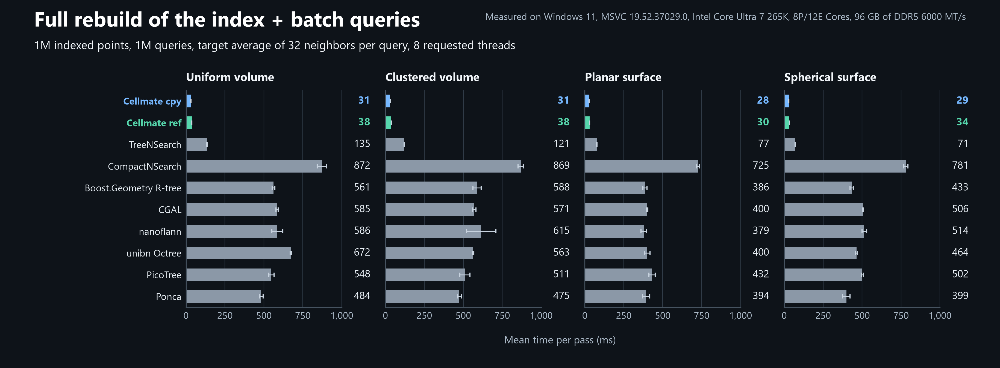

<!-- BEGIN BENCHMARK MEASUREMENTS -->
<details>
<summary>Measurements (40 rows)</summary>

Measured on Windows 11, MSVC 19.52.37029.0, Intel Core Ultra 7 265K, 8P/12E Cores, 96 GB of DDR5 6000 MT/s  
1M indexed points, 1M queries, target average of 32 neighbors per query, 8 requested threads

| Scenario | Library | Mean (ms) | Stddev (ms) | Status | Note |
| --- | --- | ---: | ---: | --- | --- |
| Uniform volume | cellmate `cpy` | 31.00 | 0.38 | OK |  |
| Uniform volume | cellmate `ref` | 37.72 | 0.29 | OK |  |
| Uniform volume | TreeNSearch | 134.85 | 1.84 | OK |  |
| Uniform volume | CompactNSearch | 872.05 | 29.95 | OK |  |
| Uniform volume | Boost.Geometry R-tree | 560.88 | 8.67 | OK |  |
| Uniform volume | CGAL | 584.77 | 7.44 | OK |  |
| Uniform volume | nanoflann | 586.26 | 34.84 | OK |  |
| Uniform volume | unibn Octree | 672.12 | 3.41 | OK |  |
| Uniform volume | PicoTree | 548.41 | 16.72 | OK |  |
| Uniform volume | Ponca | 483.54 | 11.06 | OK |  |
| Clustered volume | cellmate `cpy` | 30.83 | 0.44 | OK |  |
| Clustered volume | cellmate `ref` | 37.70 | 0.21 | OK |  |
| Clustered volume | TreeNSearch | 120.60 | 1.22 | OK |  |
| Clustered volume | CompactNSearch | 868.62 | 16.78 | OK |  |
| Clustered volume | Boost.Geometry R-tree | 587.85 | 26.20 | OK |  |
| Clustered volume | CGAL | 570.53 | 11.58 | OK |  |
| Clustered volume | nanoflann | 615.01 | 94.01 | OK |  |
| Clustered volume | unibn Octree | 562.84 | 5.22 | OK |  |
| Clustered volume | PicoTree | 510.71 | 32.41 | OK |  |
| Clustered volume | Ponca | 474.60 | 13.31 | OK |  |
| Planar surface | cellmate `cpy` | 27.96 | 0.04 | OK |  |
| Planar surface | cellmate `ref` | 30.14 | 0.14 | OK |  |
| Planar surface | TreeNSearch | 77.25 | 1.41 | OK |  |
| Planar surface | CompactNSearch | 724.81 | 8.70 | OK |  |
| Planar surface | Boost.Geometry R-tree | 385.56 | 13.17 | OK |  |
| Planar surface | CGAL | 400.23 | 4.06 | OK |  |
| Planar surface | nanoflann | 378.67 | 17.71 | OK |  |
| Planar surface | unibn Octree | 400.23 | 17.66 | OK |  |
| Planar surface | PicoTree | 431.57 | 20.08 | OK |  |
| Planar surface | Ponca | 393.87 | 22.86 | OK |  |
| Spherical surface | cellmate `cpy` | 29.06 | 0.02 | OK |  |
| Spherical surface | cellmate `ref` | 33.56 | 0.20 | OK |  |
| Spherical surface | TreeNSearch | 70.88 | 1.07 | OK |  |
| Spherical surface | CompactNSearch | 780.91 | 12.41 | OK |  |
| Spherical surface | Boost.Geometry R-tree | 432.62 | 10.22 | OK |  |
| Spherical surface | CGAL | 505.59 | 2.99 | OK |  |
| Spherical surface | nanoflann | 514.31 | 15.18 | OK |  |
| Spherical surface | unibn Octree | 464.38 | 5.78 | OK |  |
| Spherical surface | PicoTree | 501.74 | 7.33 | OK |  |
| Spherical surface | Ponca | 398.90 | 23.58 | OK |  |

</details>
<!-- END BENCHMARK MEASUREMENTS -->

### Scaling

These plots show how a full index rebuild followed by batch queries scales on a uniform point cloud. The sweeps vary indexed point count, query count, target average neighbors per query, or requested thread count one at a time. The point sweep holds the query count at 1 million.

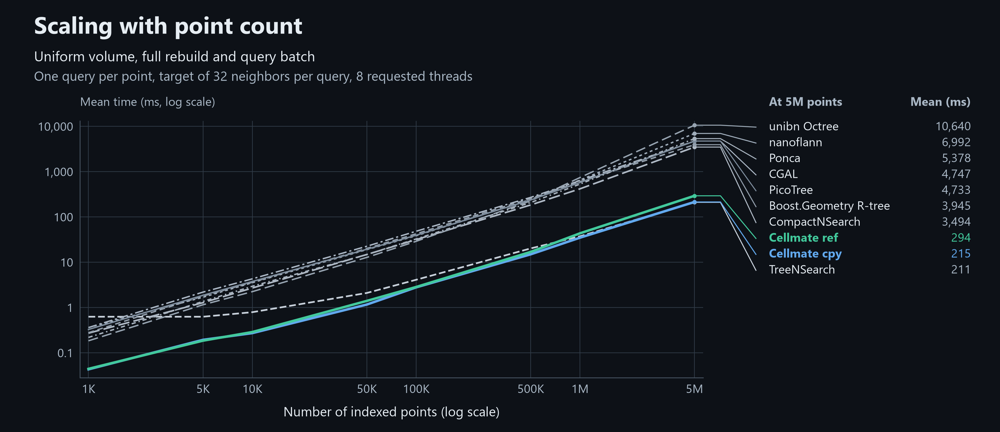

<!-- BEGIN BENCHMARK MEASUREMENTS -->
<details>
<summary>Measurements (130 rows)</summary>

Measured on Windows 11, MSVC 19.52.37029.0, Intel Core Ultra 7 265K, 8P/12E Cores, 96 GB of DDR5 6000 MT/s  
1M queries, target average of 32 neighbors per query, 8 requested threads

| Indexed points | Library | Mean (ms) | Stddev (ms) | Status | Note |
| ---: | --- | ---: | ---: | --- | --- |
| 1,000 | cellmate `cpy` | 21.56 | 0.05 | OK |  |
| 1,000 | cellmate `ref` | 21.63 | 0.17 | OK |  |
| 1,000 | TreeNSearch |  |  | Failed | Candidate limit hit at 360,490 candidates |
| 1,000 | CompactNSearch | 9527.71 | 47.51 | OK |  |
| 1,000 | Boost.Geometry R-tree | 179.35 | 12.95 | OK |  |
| 1,000 | CGAL | 244.92 | 1.55 | OK |  |
| 1,000 | nanoflann | 193.06 | 6.22 | OK |  |
| 1,000 | unibn Octree | 172.15 | 11.14 | OK |  |
| 1,000 | PicoTree | 293.20 | 11.15 | OK |  |
| 1,000 | Ponca | 192.44 | 14.33 | OK |  |
| 2,500 | cellmate `cpy` | 21.49 | 0.08 | OK |  |
| 2,500 | cellmate `ref` | 21.31 | 0.19 | OK |  |
| 2,500 | TreeNSearch | 99.90 | 0.35 | OK |  |
| 2,500 | CompactNSearch | 4116.05 | 4.44 | OK |  |
| 2,500 | Boost.Geometry R-tree | 216.95 | 15.05 | OK |  |
| 2,500 | CGAL | 271.95 | 2.90 | OK |  |
| 2,500 | nanoflann | 207.05 | 3.63 | OK |  |
| 2,500 | unibn Octree | 211.38 | 16.86 | OK |  |
| 2,500 | PicoTree | 297.28 | 3.24 | OK |  |
| 2,500 | Ponca | 211.89 | 18.12 | OK |  |
| 5,000 | cellmate `cpy` | 21.44 | 0.02 | OK |  |
| 5,000 | cellmate `ref` | 21.34 | 0.10 | OK |  |
| 5,000 | TreeNSearch | 106.05 | 1.40 | OK |  |
| 5,000 | CompactNSearch | 2256.90 | 0.80 | OK |  |
| 5,000 | Boost.Geometry R-tree | 249.61 | 2.46 | OK |  |
| 5,000 | CGAL | 292.53 | 5.33 | OK |  |
| 5,000 | nanoflann | 220.81 | 12.48 | OK |  |
| 5,000 | unibn Octree | 192.17 | 1.67 | OK |  |
| 5,000 | PicoTree | 305.43 | 14.81 | OK |  |
| 5,000 | Ponca | 221.49 | 18.24 | OK |  |
| 10,000 | cellmate `cpy` | 21.56 | 0.16 | OK |  |
| 10,000 | cellmate `ref` | 21.76 | 0.07 | OK |  |
| 10,000 | TreeNSearch | 101.98 | 0.22 | OK |  |
| 10,000 | CompactNSearch | 1415.18 | 3.27 | OK |  |
| 10,000 | Boost.Geometry R-tree | 230.83 | 13.89 | OK |  |
| 10,000 | CGAL | 312.79 | 7.59 | OK |  |
| 10,000 | nanoflann | 224.65 | 12.19 | OK |  |
| 10,000 | unibn Octree | 203.41 | 15.00 | OK |  |
| 10,000 | PicoTree | 314.04 | 7.50 | OK |  |
| 10,000 | Ponca | 238.23 | 2.03 | OK |  |
| 25,000 | cellmate `cpy` | 21.76 | 0.26 | OK |  |
| 25,000 | cellmate `ref` | 22.27 | 0.26 | OK |  |
| 25,000 | TreeNSearch | 128.51 | 0.93 | OK |  |
| 25,000 | CompactNSearch | 780.27 | 3.29 | OK |  |
| 25,000 | Boost.Geometry R-tree | 266.88 | 14.83 | OK |  |
| 25,000 | CGAL | 317.60 | 7.92 | OK |  |
| 25,000 | nanoflann | 229.74 | 13.83 | OK |  |
| 25,000 | unibn Octree | 238.38 | 9.67 | OK |  |
| 25,000 | PicoTree | 323.44 | 6.61 | OK |  |
| 25,000 | Ponca | 237.10 | 15.22 | OK |  |
| 50,000 | cellmate `cpy` | 21.86 | 0.25 | OK |  |
| 50,000 | cellmate `ref` | 22.06 | 0.26 | OK |  |
| 50,000 | TreeNSearch | 126.76 | 1.26 | OK |  |
| 50,000 | CompactNSearch | 597.66 | 9.29 | OK |  |
| 50,000 | Boost.Geometry R-tree | 265.73 | 11.08 | OK |  |
| 50,000 | CGAL | 334.13 | 8.68 | OK |  |
| 50,000 | nanoflann | 235.72 | 5.90 | OK |  |
| 50,000 | unibn Octree | 229.80 | 9.39 | OK |  |
| 50,000 | PicoTree | 310.02 | 13.16 | OK |  |
| 50,000 | Ponca | 230.42 | 5.12 | OK |  |
| 100,000 | cellmate `cpy` | 22.05 | 0.16 | OK |  |
| 100,000 | cellmate `ref` | 23.52 | 0.49 | OK |  |
| 100,000 | TreeNSearch | 163.78 | 34.10 | OK |  |
| 100,000 | CompactNSearch | 511.77 | 3.93 | OK |  |
| 100,000 | Boost.Geometry R-tree | 279.51 | 6.63 | OK |  |
| 100,000 | CGAL | 361.53 | 3.17 | OK |  |
| 100,000 | nanoflann | 274.75 | 14.90 | OK |  |
| 100,000 | unibn Octree | 264.49 | 14.31 | OK |  |
| 100,000 | PicoTree | 332.36 | 0.97 | OK |  |
| 100,000 | Ponca | 259.29 | 12.24 | OK |  |
| 250,000 | cellmate `cpy` | 23.62 | 0.20 | OK |  |
| 250,000 | cellmate `ref` | 24.29 | 0.29 | OK |  |
| 250,000 | TreeNSearch | 126.53 | 1.24 | OK |  |
| 250,000 | CompactNSearch | 527.32 | 3.41 | OK |  |
| 250,000 | Boost.Geometry R-tree | 335.75 | 15.78 | OK |  |
| 250,000 | CGAL | 388.68 | 3.29 | OK |  |
| 250,000 | nanoflann | 321.89 | 21.28 | OK |  |
| 250,000 | unibn Octree | 327.73 | 8.04 | OK |  |
| 250,000 | PicoTree | 384.78 | 27.50 | OK |  |
| 250,000 | Ponca | 295.27 | 12.67 | OK |  |
| 500,000 | cellmate `cpy` | 26.22 | 0.41 | OK |  |
| 500,000 | cellmate `ref` | 29.10 | 0.32 | OK |  |
| 500,000 | TreeNSearch | 131.90 | 0.72 | OK |  |
| 500,000 | CompactNSearch | 635.29 | 23.45 | OK |  |
| 500,000 | Boost.Geometry R-tree | 423.15 | 15.04 | OK |  |
| 500,000 | CGAL | 468.08 | 4.72 | OK |  |
| 500,000 | nanoflann | 416.64 | 7.34 | OK |  |
| 500,000 | unibn Octree | 420.39 | 17.70 | OK |  |
| 500,000 | PicoTree | 429.17 | 16.25 | OK |  |
| 500,000 | Ponca | 377.50 | 17.20 | OK |  |
| 1,000,000 | cellmate `cpy` | 29.77 | 0.15 | OK |  |
| 1,000,000 | cellmate `ref` | 38.17 | 0.36 | OK |  |
| 1,000,000 | TreeNSearch | 136.42 | 1.68 | OK |  |
| 1,000,000 | CompactNSearch | 880.13 | 24.65 | OK |  |
| 1,000,000 | Boost.Geometry R-tree | 581.53 | 8.34 | OK |  |
| 1,000,000 | CGAL | 599.18 | 2.12 | OK |  |
| 1,000,000 | nanoflann | 575.96 | 3.19 | OK |  |
| 1,000,000 | unibn Octree | 665.32 | 5.82 | OK |  |
| 1,000,000 | PicoTree | 521.02 | 32.28 | OK |  |
| 1,000,000 | Ponca | 468.12 | 13.61 | OK |  |
| 2,500,000 | cellmate `cpy` | 45.62 | 0.28 | OK |  |
| 2,500,000 | cellmate `ref` | 76.82 | 0.87 | OK |  |
| 2,500,000 | TreeNSearch | 197.54 | 3.59 | OK |  |
| 2,500,000 | CompactNSearch | 1727.27 | 22.27 | OK |  |
| 2,500,000 | Boost.Geometry R-tree | 1028.47 | 13.33 | OK |  |
| 2,500,000 | CGAL | 1132.82 | 7.80 | OK |  |
| 2,500,000 | nanoflann | 1296.60 | 22.90 | OK |  |
| 2,500,000 | unibn Octree | 1216.79 | 4.97 | OK |  |
| 2,500,000 | PicoTree | 901.46 | 28.53 | OK |  |
| 2,500,000 | Ponca | 969.19 | 11.35 | OK |  |
| 5,000,000 | cellmate `cpy` | 71.98 | 0.19 | OK |  |
| 5,000,000 | cellmate `ref` | 135.90 | 0.30 | OK |  |
| 5,000,000 | TreeNSearch | 278.50 | 1.15 | OK |  |
| 5,000,000 | CompactNSearch | 3373.11 | 38.55 | OK |  |
| 5,000,000 | Boost.Geometry R-tree | 1694.29 | 5.58 | OK |  |
| 5,000,000 | CGAL | 2027.43 | 12.29 | OK |  |
| 5,000,000 | nanoflann | 1984.36 | 7.82 | OK |  |
| 5,000,000 | unibn Octree | 2480.77 | 25.96 | OK |  |
| 5,000,000 | PicoTree | 1431.71 | 3.87 | OK |  |
| 5,000,000 | Ponca | 1772.11 | 1.96 | OK |  |
| 10,000,000 | cellmate `cpy` | 120.47 | 1.70 | OK |  |
| 10,000,000 | cellmate `ref` | 227.33 | 2.06 | OK |  |
| 10,000,000 | TreeNSearch | 466.14 | 7.84 | OK |  |
| 10,000,000 | CompactNSearch | 7108.79 | 14.19 | OK |  |
| 10,000,000 | Boost.Geometry R-tree | 3089.95 | 24.90 | OK |  |
| 10,000,000 | CGAL | 3903.55 | 11.04 | OK |  |
| 10,000,000 | nanoflann | 2822.88 | 97.64 | OK |  |
| 10,000,000 | unibn Octree | 4310.69 | 10.44 | OK |  |
| 10,000,000 | PicoTree | 2364.59 | 25.98 | OK |  |
| 10,000,000 | Ponca | 3380.98 | 22.57 | OK |  |

</details>
<!-- END BENCHMARK MEASUREMENTS -->

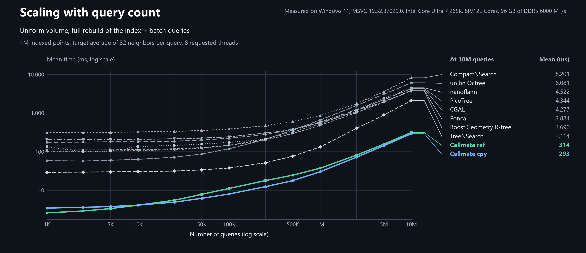

<!-- BEGIN BENCHMARK MEASUREMENTS -->
<details>
<summary>Measurements (130 rows)</summary>

Measured on Windows 11, MSVC 19.52.37029.0, Intel Core Ultra 7 265K, 8P/12E Cores, 96 GB of DDR5 6000 MT/s  
1M indexed points, target average of 32 neighbors per query, 8 requested threads

| Queries | Library | Mean (ms) | Stddev (ms) | Status | Note |
| ---: | --- | ---: | ---: | --- | --- |
| 1,000 | cellmate `cpy` | 3.47 | 0.07 | OK |  |
| 1,000 | cellmate `ref` | 2.61 | 0.04 | OK |  |
| 1,000 | TreeNSearch | 29.30 | 0.07 | OK |  |
| 1,000 | CompactNSearch | 312.46 | 6.34 | OK |  |
| 1,000 | Boost.Geometry R-tree | 204.31 | 2.75 | OK |  |
| 1,000 | CGAL | 175.67 | 2.22 | OK |  |
| 1,000 | nanoflann | 134.48 | 0.17 | OK |  |
| 1,000 | unibn Octree | 58.59 | 3.46 | OK |  |
| 1,000 | PicoTree | 102.37 | 0.30 | OK |  |
| 1,000 | Ponca | 110.79 | 2.36 | OK |  |
| 2,500 | cellmate `cpy` | 3.62 | 0.04 | OK |  |
| 2,500 | cellmate `ref` | 2.92 | 0.03 | OK |  |
| 2,500 | TreeNSearch | 29.64 | 0.26 | OK |  |
| 2,500 | CompactNSearch | 313.19 | 5.02 | OK |  |
| 2,500 | Boost.Geometry R-tree | 205.41 | 1.27 | OK |  |
| 2,500 | CGAL | 177.23 | 2.82 | OK |  |
| 2,500 | nanoflann | 101.14 | 0.22 | OK |  |
| 2,500 | unibn Octree | 57.14 | 0.54 | OK |  |
| 2,500 | PicoTree | 103.26 | 0.42 | OK |  |
| 2,500 | Ponca | 110.98 | 1.79 | OK |  |
| 5,000 | cellmate `cpy` | 3.80 | 0.02 | OK |  |
| 5,000 | cellmate `ref` | 3.36 | 0.04 | OK |  |
| 5,000 | TreeNSearch | 30.05 | 0.39 | OK |  |
| 5,000 | CompactNSearch | 318.16 | 5.00 | OK |  |
| 5,000 | Boost.Geometry R-tree | 206.65 | 2.82 | OK |  |
| 5,000 | CGAL | 179.99 | 0.67 | OK |  |
| 5,000 | nanoflann | 103.35 | 0.28 | OK |  |
| 5,000 | unibn Octree | 59.90 | 2.66 | OK |  |
| 5,000 | PicoTree | 104.17 | 0.83 | OK |  |
| 5,000 | Ponca | 111.06 | 0.21 | OK |  |
| 10,000 | cellmate `cpy` | 4.14 | 0.05 | OK |  |
| 10,000 | cellmate `ref` | 4.13 | 0.09 | OK |  |
| 10,000 | TreeNSearch | 30.53 | 0.15 | OK |  |
| 10,000 | CompactNSearch | 324.04 | 3.77 | OK |  |
| 10,000 | Boost.Geometry R-tree | 208.36 | 2.58 | OK |  |
| 10,000 | CGAL | 180.13 | 0.82 | OK |  |
| 10,000 | nanoflann | 137.12 | 0.44 | OK |  |
| 10,000 | unibn Octree | 63.52 | 2.19 | OK |  |
| 10,000 | PicoTree | 106.86 | 1.51 | OK |  |
| 10,000 | Ponca | 112.94 | 0.40 | OK |  |
| 25,000 | cellmate `cpy` | 4.93 | 0.00 | OK |  |
| 25,000 | cellmate `ref` | 5.52 | 0.14 | OK |  |
| 25,000 | TreeNSearch | 31.52 | 0.24 | OK |  |
| 25,000 | CompactNSearch | 334.89 | 2.53 | OK |  |
| 25,000 | Boost.Geometry R-tree | 216.07 | 2.69 | OK |  |
| 25,000 | CGAL | 186.44 | 1.36 | OK |  |
| 25,000 | nanoflann | 144.48 | 0.35 | OK |  |
| 25,000 | unibn Octree | 71.68 | 1.16 | OK |  |
| 25,000 | PicoTree | 113.08 | 0.34 | OK |  |
| 25,000 | Ponca | 118.78 | 1.47 | OK |  |
| 50,000 | cellmate `cpy` | 6.19 | 0.14 | OK |  |
| 50,000 | cellmate `ref` | 7.88 | 0.08 | OK |  |
| 50,000 | TreeNSearch | 33.81 | 0.18 | OK |  |
| 50,000 | CompactNSearch | 353.28 | 4.09 | OK |  |
| 50,000 | Boost.Geometry R-tree | 224.75 | 2.51 | OK |  |
| 50,000 | CGAL | 199.93 | 1.04 | OK |  |
| 50,000 | nanoflann | 157.27 | 0.68 | OK |  |
| 50,000 | unibn Octree | 86.92 | 1.21 | OK |  |
| 50,000 | PicoTree | 122.78 | 0.68 | OK |  |
| 50,000 | Ponca | 126.98 | 0.84 | OK |  |
| 100,000 | cellmate `cpy` | 8.04 | 0.06 | OK |  |
| 100,000 | cellmate `ref` | 11.18 | 0.05 | OK |  |
| 100,000 | TreeNSearch | 37.87 | 0.24 | OK |  |
| 100,000 | CompactNSearch | 386.43 | 3.77 | OK |  |
| 100,000 | Boost.Geometry R-tree | 242.50 | 4.23 | OK |  |
| 100,000 | CGAL | 222.57 | 5.15 | OK |  |
| 100,000 | nanoflann | 173.55 | 1.23 | OK |  |
| 100,000 | unibn Octree | 118.95 | 1.01 | OK |  |
| 100,000 | PicoTree | 146.02 | 0.44 | OK |  |
| 100,000 | Ponca | 146.10 | 1.14 | OK |  |
| 250,000 | cellmate `cpy` | 12.43 | 0.09 | OK |  |
| 250,000 | cellmate `ref` | 17.85 | 0.09 | OK |  |
| 250,000 | TreeNSearch | 51.51 | 0.42 | OK |  |
| 250,000 | CompactNSearch | 468.30 | 3.40 | OK |  |
| 250,000 | Boost.Geometry R-tree | 303.35 | 5.47 | OK |  |
| 250,000 | CGAL | 277.99 | 0.91 | OK |  |
| 250,000 | nanoflann | 209.70 | 1.98 | OK |  |
| 250,000 | unibn Octree | 207.66 | 2.35 | OK |  |
| 250,000 | PicoTree | 210.68 | 2.17 | OK |  |
| 250,000 | Ponca | 201.12 | 5.40 | OK |  |
| 500,000 | cellmate `cpy` | 17.81 | 0.20 | OK |  |
| 500,000 | cellmate `ref` | 24.69 | 0.13 | OK |  |
| 500,000 | TreeNSearch | 76.59 | 1.17 | OK |  |
| 500,000 | CompactNSearch | 603.73 | 18.88 | OK |  |
| 500,000 | Boost.Geometry R-tree | 379.57 | 2.98 | OK |  |
| 500,000 | CGAL | 378.71 | 0.62 | OK |  |
| 500,000 | nanoflann | 354.31 | 2.05 | OK |  |
| 500,000 | unibn Octree | 364.97 | 3.81 | OK |  |
| 500,000 | PicoTree | 321.83 | 4.28 | OK |  |
| 500,000 | Ponca | 295.53 | 4.73 | OK |  |
| 1,000,000 | cellmate `cpy` | 30.34 | 0.43 | OK |  |
| 1,000,000 | cellmate `ref` | 37.39 | 0.42 | OK |  |
| 1,000,000 | TreeNSearch | 132.94 | 0.18 | OK |  |
| 1,000,000 | CompactNSearch | 857.13 | 11.91 | OK |  |
| 1,000,000 | Boost.Geometry R-tree | 560.24 | 3.40 | OK |  |
| 1,000,000 | CGAL | 584.06 | 7.42 | OK |  |
| 1,000,000 | nanoflann | 590.19 | 30.57 | OK |  |
| 1,000,000 | unibn Octree | 659.51 | 16.15 | OK |  |
| 1,000,000 | PicoTree | 530.06 | 23.81 | OK |  |
| 1,000,000 | Ponca | 481.82 | 3.19 | OK |  |
| 2,500,000 | cellmate `cpy` | 72.14 | 0.49 | OK |  |
| 2,500,000 | cellmate `ref` | 81.45 | 0.41 | OK |  |
| 2,500,000 | TreeNSearch | 400.45 | 9.62 | OK |  |
| 2,500,000 | CompactNSearch | 1754.34 | 7.53 | OK |  |
| 2,500,000 | Boost.Geometry R-tree | 1098.49 | 23.70 | OK |  |
| 2,500,000 | CGAL | 1193.70 | 19.09 | OK |  |
| 2,500,000 | nanoflann | 1229.86 | 81.93 | OK |  |
| 2,500,000 | unibn Octree | 1568.50 | 24.61 | OK |  |
| 2,500,000 | PicoTree | 1159.86 | 85.27 | OK |  |
| 2,500,000 | Ponca | 1027.10 | 45.31 | OK |  |
| 5,000,000 | cellmate `cpy` | 143.39 | 2.66 | OK |  |
| 5,000,000 | cellmate `ref` | 156.69 | 0.48 | OK |  |
| 5,000,000 | TreeNSearch | 892.56 | 1.92 | OK |  |
| 5,000,000 | CompactNSearch | 3598.24 | 28.96 | OK |  |
| 5,000,000 | Boost.Geometry R-tree | 1999.33 | 43.77 | OK |  |
| 5,000,000 | CGAL | 2231.95 | 34.67 | OK |  |
| 5,000,000 | nanoflann | 2410.26 | 39.67 | OK |  |
| 5,000,000 | unibn Octree | 3082.23 | 52.06 | OK |  |
| 5,000,000 | PicoTree | 2223.35 | 126.80 | OK |  |
| 5,000,000 | Ponca | 1916.37 | 88.32 | OK |  |
| 10,000,000 | cellmate `cpy` | 293.37 | 6.80 | OK |  |
| 10,000,000 | cellmate `ref` | 314.24 | 2.56 | OK |  |
| 10,000,000 | TreeNSearch | 2114.26 | 37.16 | OK |  |
| 10,000,000 | CompactNSearch | 8200.65 | 62.19 | OK |  |
| 10,000,000 | Boost.Geometry R-tree | 3689.57 | 33.31 | OK |  |
| 10,000,000 | CGAL | 4277.40 | 67.81 | OK |  |
| 10,000,000 | nanoflann | 4521.82 | 142.58 | OK |  |
| 10,000,000 | unibn Octree | 6081.11 | 77.71 | OK |  |
| 10,000,000 | PicoTree | 4344.00 | 345.38 | OK |  |
| 10,000,000 | Ponca | 3884.01 | 53.49 | OK |  |

</details>
<!-- END BENCHMARK MEASUREMENTS -->

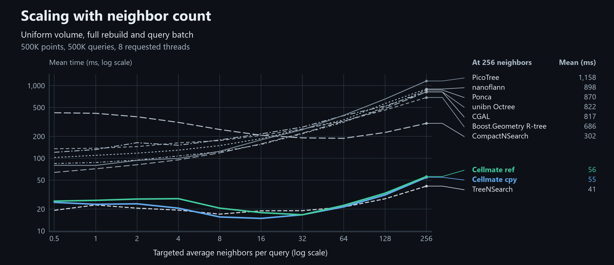

<!-- BEGIN BENCHMARK MEASUREMENTS -->
<details>
<summary>Measurements (110 rows)</summary>

Measured on Windows 11, MSVC 19.52.37029.0, Intel Core Ultra 7 265K, 8P/12E Cores, 96 GB of DDR5 6000 MT/s  
1M indexed points, 1M queries, 8 requested threads

| Target average neighbors per query | Library | Mean (ms) | Stddev (ms) | Status | Note |
| ---: | --- | ---: | ---: | --- | --- |
| 0.5 | cellmate `cpy` | 37.56 | 0.23 | OK |  |
| 0.5 | cellmate `ref` | 43.44 | 0.05 | OK |  |
| 0.5 | TreeNSearch | 62.30 | 0.59 | OK |  |
| 0.5 | CompactNSearch | 1694.44 | 19.86 | OK |  |
| 0.5 | Boost.Geometry R-tree | 290.90 | 2.54 | OK |  |
| 0.5 | CGAL | 275.49 | 1.13 | OK |  |
| 0.5 | nanoflann | 228.27 | 0.60 | OK |  |
| 0.5 | unibn Octree | 206.62 | 2.37 | OK |  |
| 0.5 | PicoTree | 173.27 | 0.69 | OK |  |
| 0.5 | Ponca | 197.76 | 1.52 | OK |  |
| 1 | cellmate `cpy` | 38.21 | 0.19 | OK |  |
| 1 | cellmate `ref` | 46.74 | 1.35 | OK |  |
| 1 | TreeNSearch | 64.63 | 0.79 | OK |  |
| 1 | CompactNSearch | 1667.20 | 43.07 | OK |  |
| 1 | Boost.Geometry R-tree | 302.13 | 2.36 | OK |  |
| 1 | CGAL | 287.84 | 3.02 | OK |  |
| 1 | nanoflann | 252.96 | 0.88 | OK |  |
| 1 | unibn Octree | 230.98 | 4.08 | OK |  |
| 1 | PicoTree | 185.62 | 0.19 | OK |  |
| 1 | Ponca | 212.02 | 2.83 | OK |  |
| 2 | cellmate `cpy` | 37.74 | 0.48 | OK |  |
| 2 | cellmate `ref` | 48.82 | 1.69 | OK |  |
| 2 | TreeNSearch | 66.26 | 0.61 | OK |  |
| 2 | CompactNSearch | 1604.94 | 20.30 | OK |  |
| 2 | Boost.Geometry R-tree | 325.03 | 2.00 | OK |  |
| 2 | CGAL | 308.62 | 5.00 | OK |  |
| 2 | nanoflann | 273.91 | 2.79 | OK |  |
| 2 | unibn Octree | 262.19 | 5.20 | OK |  |
| 2 | PicoTree | 202.93 | 4.42 | OK |  |
| 2 | Ponca | 223.40 | 1.62 | OK |  |
| 4 | cellmate `cpy` | 36.05 | 0.15 | OK |  |
| 4 | cellmate `ref` | 47.81 | 0.89 | OK |  |
| 4 | TreeNSearch | 68.98 | 0.53 | OK |  |
| 4 | CompactNSearch | 1548.35 | 13.43 | OK |  |
| 4 | Boost.Geometry R-tree | 347.65 | 2.55 | OK |  |
| 4 | CGAL | 337.41 | 0.48 | OK |  |
| 4 | nanoflann | 273.38 | 2.63 | OK |  |
| 4 | unibn Octree | 310.39 | 12.64 | OK |  |
| 4 | PicoTree | 226.88 | 2.53 | OK |  |
| 4 | Ponca | 247.27 | 3.69 | OK |  |
| 8 | cellmate `cpy` | 31.12 | 0.20 | OK |  |
| 8 | cellmate `ref` | 41.38 | 0.56 | OK |  |
| 8 | TreeNSearch | 80.48 | 0.99 | OK |  |
| 8 | CompactNSearch | 1333.64 | 23.49 | OK |  |
| 8 | Boost.Geometry R-tree | 393.55 | 4.81 | OK |  |
| 8 | CGAL | 388.05 | 0.49 | OK |  |
| 8 | nanoflann | 353.82 | 4.16 | OK |  |
| 8 | unibn Octree | 383.75 | 7.84 | OK |  |
| 8 | PicoTree | 276.56 | 11.73 | OK |  |
| 8 | Ponca | 284.61 | 3.13 | OK |  |
| 16 | cellmate `cpy` | 28.84 | 0.09 | OK |  |
| 16 | cellmate `ref` | 37.06 | 1.37 | OK |  |
| 16 | TreeNSearch | 83.50 | 0.36 | OK |  |
| 16 | CompactNSearch | 1011.90 | 9.32 | OK |  |
| 16 | Boost.Geometry R-tree | 456.32 | 1.81 | OK |  |
| 16 | CGAL | 465.12 | 3.78 | OK |  |
| 16 | nanoflann | 429.30 | 9.05 | OK |  |
| 16 | unibn Octree | 512.78 | 12.81 | OK |  |
| 16 | PicoTree | 380.41 | 6.35 | OK |  |
| 16 | Ponca | 361.01 | 3.02 | OK |  |
| 32 | cellmate `cpy` | 30.35 | 0.29 | OK |  |
| 32 | cellmate `ref` | 40.65 | 0.13 | OK |  |
| 32 | TreeNSearch | 132.83 | 1.68 | OK |  |
| 32 | CompactNSearch | 874.15 | 27.48 | OK |  |
| 32 | Boost.Geometry R-tree | 557.93 | 4.55 | OK |  |
| 32 | CGAL | 588.91 | 5.71 | OK |  |
| 32 | nanoflann | 547.33 | 20.78 | OK |  |
| 32 | unibn Octree | 666.86 | 16.71 | OK |  |
| 32 | PicoTree | 530.48 | 24.67 | OK |  |
| 32 | Ponca | 463.50 | 22.04 | OK |  |
| 64 | cellmate `cpy` | 41.41 | 0.44 | OK |  |
| 64 | cellmate `ref` | 51.64 | 0.86 | OK |  |
| 64 | TreeNSearch | 142.89 | 1.30 | OK |  |
| 64 | CompactNSearch | 877.48 | 4.10 | OK |  |
| 64 | Boost.Geometry R-tree | 746.11 | 10.79 | OK |  |
| 64 | CGAL | 793.99 | 15.04 | OK |  |
| 64 | nanoflann | 802.58 | 17.48 | OK |  |
| 64 | unibn Octree | 930.54 | 23.28 | OK |  |
| 64 | PicoTree | 802.60 | 26.98 | OK |  |
| 64 | Ponca | 712.47 | 50.50 | OK |  |
| 128 | cellmate `cpy` | 61.46 | 1.19 | OK |  |
| 128 | cellmate `ref` | 75.24 | 0.48 | OK |  |
| 128 | TreeNSearch | 156.79 | 2.23 | OK |  |
| 128 | CompactNSearch | 1036.04 | 14.26 | OK |  |
| 128 | Boost.Geometry R-tree | 1038.35 | 42.92 | OK |  |
| 128 | CGAL | 1079.04 | 20.06 | OK |  |
| 128 | nanoflann | 1271.68 | 28.73 | OK |  |
| 128 | unibn Octree | 1445.08 | 36.07 | OK |  |
| 128 | PicoTree | 1425.86 | 17.76 | OK |  |
| 128 | Ponca | 1069.85 | 79.62 | OK |  |
| 256 | cellmate `cpy` | 104.07 | 1.39 | OK |  |
| 256 | cellmate `ref` | 120.72 | 1.27 | OK |  |
| 256 | TreeNSearch | 195.15 | 5.60 | OK |  |
| 256 | CompactNSearch | 1460.05 | 8.82 | OK |  |
| 256 | Boost.Geometry R-tree | 1547.89 | 6.07 | OK |  |
| 256 | CGAL | 1707.42 | 46.78 | OK |  |
| 256 | nanoflann | 2091.14 | 99.65 | OK |  |
| 256 | unibn Octree | 2495.87 | 295.06 | OK |  |
| 256 | PicoTree | 2551.13 | 79.55 | OK |  |
| 256 | Ponca | 1801.60 | 43.02 | OK |  |
| 512 | cellmate `cpy` | 208.29 | 36.59 | OK |  |
| 512 | cellmate `ref` | 195.57 | 0.89 | OK |  |
| 512 | TreeNSearch | 262.03 | 6.70 | OK |  |
| 512 | CompactNSearch | 2270.84 | 22.03 | OK |  |
| 512 | Boost.Geometry R-tree | 2628.97 | 100.40 | OK |  |
| 512 | CGAL | 2706.25 | 176.84 | OK |  |
| 512 | nanoflann | 3508.46 | 45.58 | OK |  |
| 512 | unibn Octree | 3753.40 | 188.61 | OK |  |
| 512 | PicoTree | 4686.13 | 112.09 | OK |  |
| 512 | Ponca | 3245.22 | 139.39 | OK |  |

</details>
<!-- END BENCHMARK MEASUREMENTS -->

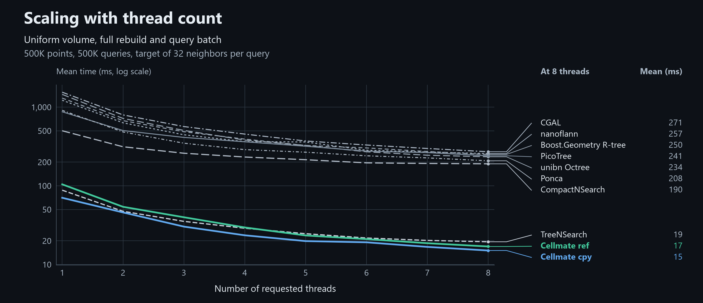

<!-- BEGIN BENCHMARK MEASUREMENTS -->
<details>
<summary>Measurements (80 rows)</summary>

Measured on Windows 11, MSVC 19.52.37029.0, Intel Core Ultra 7 265K, 8P/12E Cores, 96 GB of DDR5 6000 MT/s  
500K indexed points, 500K queries, target average of 32 neighbors per query

| Requested threads | Library | Mean (ms) | Stddev (ms) | Status | Note |
| ---: | --- | ---: | ---: | --- | --- |
| 1 | cellmate `cpy` | 88.56 | 2.13 | OK |  |
| 1 | cellmate `ref` | 86.99 | 1.28 | OK |  |
| 1 | TreeNSearch | 375.76 | 4.76 | OK |  |
| 1 | CompactNSearch | 1137.63 | 29.55 | OK |  |
| 1 | Boost.Geometry R-tree | 1146.06 | 30.69 | OK |  |
| 1 | CGAL | 1358.98 | 21.04 | OK |  |
| 1 | nanoflann | 1020.70 | 28.76 | OK |  |
| 1 | unibn Octree | 1383.36 | 1.34 | OK |  |
| 1 | PicoTree | 803.87 | 12.03 | OK |  |
| 1 | Ponca | 832.40 | 9.45 | OK |  |
| 2 | cellmate `cpy` | 37.38 | 0.32 | OK |  |
| 2 | cellmate `ref` | 49.56 | 1.04 | OK |  |
| 2 | TreeNSearch | 192.66 | 2.06 | OK |  |
| 2 | CompactNSearch | 742.32 | 13.34 | OK |  |
| 2 | Boost.Geometry R-tree | 622.66 | 10.08 | OK |  |
| 2 | CGAL | 735.91 | 9.35 | OK |  |
| 2 | nanoflann | 574.20 | 3.83 | OK |  |
| 2 | unibn Octree | 685.41 | 6.28 | OK |  |
| 2 | PicoTree | 502.96 | 11.97 | OK |  |
| 2 | Ponca | 460.86 | 10.31 | OK |  |
| 3 | cellmate `cpy` | 27.84 | 0.12 | OK |  |
| 3 | cellmate `ref` | 34.87 | 0.19 | OK |  |
| 3 | TreeNSearch | 135.39 | 2.43 | OK |  |
| 3 | CompactNSearch | 582.40 | 14.38 | OK |  |
| 3 | Boost.Geometry R-tree | 446.16 | 1.72 | OK |  |
| 3 | CGAL | 535.63 | 6.06 | OK |  |
| 3 | nanoflann | 428.84 | 8.51 | OK |  |
| 3 | unibn Octree | 481.95 | 1.19 | OK |  |
| 3 | PicoTree | 392.70 | 58.19 | OK |  |
| 3 | Ponca | 353.98 | 16.95 | OK |  |
| 4 | cellmate `cpy` | 22.06 | 0.14 | OK |  |
| 4 | cellmate `ref` | 27.20 | 0.38 | OK |  |
| 4 | TreeNSearch | 104.52 | 1.96 | OK |  |
| 4 | CompactNSearch | 510.83 | 10.35 | OK |  |
| 4 | Boost.Geometry R-tree | 371.63 | 2.56 | OK |  |
| 4 | CGAL | 430.10 | 9.43 | OK |  |
| 4 | nanoflann | 355.94 | 23.08 | OK |  |
| 4 | unibn Octree | 374.38 | 6.11 | OK |  |
| 4 | PicoTree | 372.91 | 5.30 | OK |  |
| 4 | Ponca | 280.22 | 1.62 | OK |  |
| 5 | cellmate `cpy` | 19.43 | 0.11 | OK |  |
| 5 | cellmate `ref` | 22.92 | 0.35 | OK |  |
| 5 | TreeNSearch | 86.72 | 0.88 | OK |  |
| 5 | CompactNSearch | 457.76 | 6.36 | OK |  |
| 5 | Boost.Geometry R-tree | 310.36 | 1.62 | OK |  |
| 5 | CGAL | 359.46 | 3.05 | OK |  |
| 5 | nanoflann | 288.57 | 1.97 | OK |  |
| 5 | unibn Octree | 304.52 | 1.04 | OK |  |
| 5 | PicoTree | 260.68 | 1.61 | OK |  |
| 5 | Ponca | 258.11 | 2.93 | OK |  |
| 6 | cellmate `cpy` | 16.64 | 0.04 | OK |  |
| 6 | cellmate `ref` | 20.07 | 0.08 | OK |  |
| 6 | TreeNSearch | 74.93 | 0.34 | OK |  |
| 6 | CompactNSearch | 424.86 | 7.17 | OK |  |
| 6 | Boost.Geometry R-tree | 286.10 | 6.52 | OK |  |
| 6 | CGAL | 318.08 | 6.05 | OK |  |
| 6 | nanoflann | 281.42 | 3.40 | OK |  |
| 6 | unibn Octree | 264.27 | 2.02 | OK |  |
| 6 | PicoTree | 270.06 | 2.94 | OK |  |
| 6 | Ponca | 232.05 | 9.41 | OK |  |
| 7 | cellmate `cpy` | 15.54 | 0.18 | OK |  |
| 7 | cellmate `ref` | 17.43 | 0.27 | OK |  |
| 7 | TreeNSearch | 66.81 | 0.36 | OK |  |
| 7 | CompactNSearch | 406.67 | 0.93 | OK |  |
| 7 | Boost.Geometry R-tree | 263.57 | 8.57 | OK |  |
| 7 | CGAL | 289.90 | 4.28 | OK |  |
| 7 | nanoflann | 252.94 | 7.86 | OK |  |
| 7 | unibn Octree | 240.54 | 6.41 | OK |  |
| 7 | PicoTree | 254.25 | 14.72 | OK |  |
| 7 | Ponca | 214.97 | 10.86 | OK |  |
| 8 | cellmate `cpy` | 14.40 | 0.11 | OK |  |
| 8 | cellmate `ref` | 16.19 | 0.03 | OK |  |
| 8 | TreeNSearch | 61.65 | 0.65 | OK |  |
| 8 | CompactNSearch | 397.98 | 8.47 | OK |  |
| 8 | Boost.Geometry R-tree | 237.19 | 1.66 | OK |  |
| 8 | CGAL | 266.49 | 1.42 | OK |  |
| 8 | nanoflann | 237.34 | 1.25 | OK |  |
| 8 | unibn Octree | 220.70 | 1.07 | OK |  |
| 8 | PicoTree | 233.57 | 14.22 | OK |  |
| 8 | Ponca | 207.09 | 4.67 | OK |  |

</details>
<!-- END BENCHMARK MEASUREMENTS -->

### Peak memory

The first figure shows how peak memory changes with indexed point count, query count, and target average neighbors per query. The second compares peak memory across different point distributions at a fixed workload. The peak memory usage includes fixture generation, the index, warmup, and retained results.

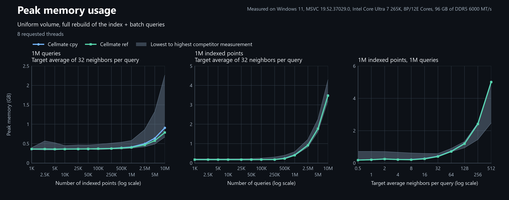

<!-- BEGIN BENCHMARK MEASUREMENTS -->
<details>
<summary>Measurements (370 rows)</summary>

Measured on Windows 11, MSVC 19.52.37029.0, Intel Core Ultra 7 265K, 8P/12E Cores, 96 GB of DDR5 6000 MT/s

**Indexed points**

1M queries, target average of 32 neighbors per query, 8 requested threads

| Indexed points | Library | Peak memory (GB) | Status | Note |
| ---: | --- | ---: | --- | --- |
| 1,000 | cellmate `cpy` | 0.36 | OK |  |
| 1,000 | cellmate `ref` | 0.36 | OK |  |
| 1,000 | TreeNSearch |  | Failed | Candidate limit hit at 360,490 candidates |
| 1,000 | CompactNSearch | 0.40 | OK |  |
| 1,000 | Boost.Geometry R-tree | 0.35 | OK |  |
| 1,000 | CGAL | 0.35 | OK |  |
| 1,000 | nanoflann | 0.35 | OK |  |
| 1,000 | unibn Octree | 0.34 | OK |  |
| 1,000 | PicoTree | 0.35 | OK |  |
| 1,000 | Ponca | 0.35 | OK |  |
| 2,500 | cellmate `cpy` | 0.36 | OK |  |
| 2,500 | cellmate `ref` | 0.36 | OK |  |
| 2,500 | TreeNSearch | 0.57 | OK |  |
| 2,500 | CompactNSearch | 0.39 | OK |  |
| 2,500 | Boost.Geometry R-tree | 0.35 | OK |  |
| 2,500 | CGAL | 0.35 | OK |  |
| 2,500 | nanoflann | 0.35 | OK |  |
| 2,500 | unibn Octree | 0.34 | OK |  |
| 2,500 | PicoTree | 0.35 | OK |  |
| 2,500 | Ponca | 0.35 | OK |  |
| 5,000 | cellmate `cpy` | 0.36 | OK |  |
| 5,000 | cellmate `ref` | 0.36 | OK |  |
| 5,000 | TreeNSearch | 0.52 | OK |  |
| 5,000 | CompactNSearch | 0.39 | OK |  |
| 5,000 | Boost.Geometry R-tree | 0.35 | OK |  |
| 5,000 | CGAL | 0.35 | OK |  |
| 5,000 | nanoflann | 0.35 | OK |  |
| 5,000 | unibn Octree | 0.34 | OK |  |
| 5,000 | PicoTree | 0.35 | OK |  |
| 5,000 | Ponca | 0.35 | OK |  |
| 10,000 | cellmate `cpy` | 0.36 | OK |  |
| 10,000 | cellmate `ref` | 0.36 | OK |  |
| 10,000 | TreeNSearch | 0.45 | OK |  |
| 10,000 | CompactNSearch | 0.39 | OK |  |
| 10,000 | Boost.Geometry R-tree | 0.35 | OK |  |
| 10,000 | CGAL | 0.35 | OK |  |
| 10,000 | nanoflann | 0.35 | OK |  |
| 10,000 | unibn Octree | 0.35 | OK |  |
| 10,000 | PicoTree | 0.35 | OK |  |
| 10,000 | Ponca | 0.35 | OK |  |
| 25,000 | cellmate `cpy` | 0.36 | OK |  |
| 25,000 | cellmate `ref` | 0.36 | OK |  |
| 25,000 | TreeNSearch | 0.47 | OK |  |
| 25,000 | CompactNSearch | 0.39 | OK |  |
| 25,000 | Boost.Geometry R-tree | 0.35 | OK |  |
| 25,000 | CGAL | 0.35 | OK |  |
| 25,000 | nanoflann | 0.35 | OK |  |
| 25,000 | unibn Octree | 0.35 | OK |  |
| 25,000 | PicoTree | 0.35 | OK |  |
| 25,000 | Ponca | 0.35 | OK |  |
| 50,000 | cellmate `cpy` | 0.36 | OK |  |
| 50,000 | cellmate `ref` | 0.36 | OK |  |
| 50,000 | TreeNSearch | 0.46 | OK |  |
| 50,000 | CompactNSearch | 0.40 | OK |  |
| 50,000 | Boost.Geometry R-tree | 0.36 | OK |  |
| 50,000 | CGAL | 0.36 | OK |  |
| 50,000 | nanoflann | 0.35 | OK |  |
| 50,000 | unibn Octree | 0.36 | OK |  |
| 50,000 | PicoTree | 0.35 | OK |  |
| 50,000 | Ponca | 0.35 | OK |  |
| 100,000 | cellmate `cpy` | 0.37 | OK |  |
| 100,000 | cellmate `ref` | 0.37 | OK |  |
| 100,000 | TreeNSearch | 0.48 | OK |  |
| 100,000 | CompactNSearch | 0.41 | OK |  |
| 100,000 | Boost.Geometry R-tree | 0.36 | OK |  |
| 100,000 | CGAL | 0.36 | OK |  |
| 100,000 | nanoflann | 0.36 | OK |  |
| 100,000 | unibn Octree | 0.34 | OK |  |
| 100,000 | PicoTree | 0.36 | OK |  |
| 100,000 | Ponca | 0.36 | OK |  |
| 250,000 | cellmate `cpy` | 0.37 | OK |  |
| 250,000 | cellmate `ref` | 0.37 | OK |  |
| 250,000 | TreeNSearch | 0.51 | OK |  |
| 250,000 | CompactNSearch | 0.44 | OK |  |
| 250,000 | Boost.Geometry R-tree | 0.37 | OK |  |
| 250,000 | CGAL | 0.37 | OK |  |
| 250,000 | nanoflann | 0.36 | OK |  |
| 250,000 | unibn Octree | 0.36 | OK |  |
| 250,000 | PicoTree | 0.36 | OK |  |
| 250,000 | Ponca | 0.36 | OK |  |
| 500,000 | cellmate `cpy` | 0.39 | OK |  |
| 500,000 | cellmate `ref` | 0.38 | OK |  |
| 500,000 | TreeNSearch | 0.54 | OK |  |
| 500,000 | CompactNSearch | 0.49 | OK |  |
| 500,000 | Boost.Geometry R-tree | 0.40 | OK |  |
| 500,000 | CGAL | 0.39 | OK |  |
| 500,000 | nanoflann | 0.37 | OK |  |
| 500,000 | unibn Octree | 0.36 | OK |  |
| 500,000 | PicoTree | 0.37 | OK |  |
| 500,000 | Ponca | 0.38 | OK |  |
| 1,000,000 | cellmate `cpy` | 0.41 | OK |  |
| 1,000,000 | cellmate `ref` | 0.40 | OK |  |
| 1,000,000 | TreeNSearch | 0.55 | OK |  |
| 1,000,000 | CompactNSearch | 0.58 | OK |  |
| 1,000,000 | Boost.Geometry R-tree | 0.44 | OK |  |
| 1,000,000 | CGAL | 0.43 | OK |  |
| 1,000,000 | nanoflann | 0.38 | OK |  |
| 1,000,000 | unibn Octree | 0.39 | OK |  |
| 1,000,000 | PicoTree | 0.39 | OK |  |
| 1,000,000 | Ponca | 0.40 | OK |  |
| 2,500,000 | cellmate `cpy` | 0.50 | OK |  |
| 2,500,000 | cellmate `ref` | 0.47 | OK |  |
| 2,500,000 | TreeNSearch | 0.72 | OK |  |
| 2,500,000 | CompactNSearch | 0.86 | OK |  |
| 2,500,000 | Boost.Geometry R-tree | 0.58 | OK |  |
| 2,500,000 | CGAL | 0.55 | OK |  |
| 2,500,000 | nanoflann | 0.42 | OK |  |
| 2,500,000 | unibn Octree | 0.46 | OK |  |
| 2,500,000 | PicoTree | 0.45 | OK |  |
| 2,500,000 | Ponca | 0.47 | OK |  |
| 5,000,000 | cellmate `cpy` | 0.64 | OK |  |
| 5,000,000 | cellmate `ref` | 0.58 | OK |  |
| 5,000,000 | TreeNSearch | 0.96 | OK |  |
| 5,000,000 | CompactNSearch | 1.33 | OK |  |
| 5,000,000 | Boost.Geometry R-tree | 0.82 | OK |  |
| 5,000,000 | CGAL | 0.74 | OK |  |
| 5,000,000 | nanoflann | 0.49 | OK |  |
| 5,000,000 | unibn Octree | 0.53 | OK |  |
| 5,000,000 | PicoTree | 0.54 | OK |  |
| 5,000,000 | Ponca | 0.58 | OK |  |
| 10,000,000 | cellmate `cpy` | 0.91 | OK |  |
| 10,000,000 | cellmate `ref` | 0.78 | OK |  |
| 10,000,000 | TreeNSearch | 1.46 | OK |  |
| 10,000,000 | CompactNSearch | 2.26 | OK |  |
| 10,000,000 | Boost.Geometry R-tree | 1.28 | OK |  |
| 10,000,000 | CGAL | 1.14 | OK |  |
| 10,000,000 | nanoflann | 0.67 | OK |  |
| 10,000,000 | unibn Octree | 0.88 | OK |  |
| 10,000,000 | PicoTree | 0.73 | OK |  |
| 10,000,000 | Ponca | 0.81 | OK |  |

**Queries**

1M indexed points, target average of 32 neighbors per query, 8 requested threads

| Queries | Library | Peak memory (GB) | Status | Note |
| ---: | --- | ---: | --- | --- |
| 1,000 | cellmate `cpy` | 0.17 | OK |  |
| 1,000 | cellmate `ref` | 0.17 | OK |  |
| 1,000 | TreeNSearch | 0.17 | OK |  |
| 1,000 | CompactNSearch | 0.22 | OK |  |
| 1,000 | Boost.Geometry R-tree | 0.17 | OK |  |
| 1,000 | CGAL | 0.17 | OK |  |
| 1,000 | nanoflann | 0.17 | OK |  |
| 1,000 | unibn Octree | 0.17 | OK |  |
| 1,000 | PicoTree | 0.18 | OK |  |
| 1,000 | Ponca | 0.17 | OK |  |
| 2,500 | cellmate `cpy` | 0.17 | OK |  |
| 2,500 | cellmate `ref` | 0.17 | OK |  |
| 2,500 | TreeNSearch | 0.17 | OK |  |
| 2,500 | CompactNSearch | 0.22 | OK |  |
| 2,500 | Boost.Geometry R-tree | 0.17 | OK |  |
| 2,500 | CGAL | 0.17 | OK |  |
| 2,500 | nanoflann | 0.17 | OK |  |
| 2,500 | unibn Octree | 0.17 | OK |  |
| 2,500 | PicoTree | 0.17 | OK |  |
| 2,500 | Ponca | 0.17 | OK |  |
| 5,000 | cellmate `cpy` | 0.17 | OK |  |
| 5,000 | cellmate `ref` | 0.17 | OK |  |
| 5,000 | TreeNSearch | 0.17 | OK |  |
| 5,000 | CompactNSearch | 0.22 | OK |  |
| 5,000 | Boost.Geometry R-tree | 0.17 | OK |  |
| 5,000 | CGAL | 0.17 | OK |  |
| 5,000 | nanoflann | 0.17 | OK |  |
| 5,000 | unibn Octree | 0.17 | OK |  |
| 5,000 | PicoTree | 0.17 | OK |  |
| 5,000 | Ponca | 0.17 | OK |  |
| 10,000 | cellmate `cpy` | 0.17 | OK |  |
| 10,000 | cellmate `ref` | 0.17 | OK |  |
| 10,000 | TreeNSearch | 0.17 | OK |  |
| 10,000 | CompactNSearch | 0.22 | OK |  |
| 10,000 | Boost.Geometry R-tree | 0.17 | OK |  |
| 10,000 | CGAL | 0.17 | OK |  |
| 10,000 | nanoflann | 0.17 | OK |  |
| 10,000 | unibn Octree | 0.17 | OK |  |
| 10,000 | PicoTree | 0.17 | OK |  |
| 10,000 | Ponca | 0.17 | OK |  |
| 25,000 | cellmate `cpy` | 0.17 | OK |  |
| 25,000 | cellmate `ref` | 0.17 | OK |  |
| 25,000 | TreeNSearch | 0.17 | OK |  |
| 25,000 | CompactNSearch | 0.23 | OK |  |
| 25,000 | Boost.Geometry R-tree | 0.17 | OK |  |
| 25,000 | CGAL | 0.17 | OK |  |
| 25,000 | nanoflann | 0.17 | OK |  |
| 25,000 | unibn Octree | 0.17 | OK |  |
| 25,000 | PicoTree | 0.17 | OK |  |
| 25,000 | Ponca | 0.17 | OK |  |
| 50,000 | cellmate `cpy` | 0.17 | OK |  |
| 50,000 | cellmate `ref` | 0.17 | OK |  |
| 50,000 | TreeNSearch | 0.18 | OK |  |
| 50,000 | CompactNSearch | 0.23 | OK |  |
| 50,000 | Boost.Geometry R-tree | 0.17 | OK |  |
| 50,000 | CGAL | 0.17 | OK |  |
| 50,000 | nanoflann | 0.17 | OK |  |
| 50,000 | unibn Octree | 0.18 | OK |  |
| 50,000 | PicoTree | 0.17 | OK |  |
| 50,000 | Ponca | 0.17 | OK |  |
| 100,000 | cellmate `cpy` | 0.18 | OK |  |
| 100,000 | cellmate `ref` | 0.18 | OK |  |
| 100,000 | TreeNSearch | 0.18 | OK |  |
| 100,000 | CompactNSearch | 0.25 | OK |  |
| 100,000 | Boost.Geometry R-tree | 0.17 | OK |  |
| 100,000 | CGAL | 0.18 | OK |  |
| 100,000 | nanoflann | 0.17 | OK |  |
| 100,000 | unibn Octree | 0.18 | OK |  |
| 100,000 | PicoTree | 0.17 | OK |  |
| 100,000 | Ponca | 0.18 | OK |  |
| 250,000 | cellmate `cpy` | 0.18 | OK |  |
| 250,000 | cellmate `ref` | 0.18 | OK |  |
| 250,000 | TreeNSearch | 0.24 | OK |  |
| 250,000 | CompactNSearch | 0.31 | OK |  |
| 250,000 | Boost.Geometry R-tree | 0.19 | OK |  |
| 250,000 | CGAL | 0.18 | OK |  |
| 250,000 | nanoflann | 0.18 | OK |  |
| 250,000 | unibn Octree | 0.18 | OK |  |
| 250,000 | PicoTree | 0.18 | OK |  |
| 250,000 | Ponca | 0.18 | OK |  |
| 500,000 | cellmate `cpy` | 0.24 | OK |  |
| 500,000 | cellmate `ref` | 0.23 | OK |  |
| 500,000 | TreeNSearch | 0.36 | OK |  |
| 500,000 | CompactNSearch | 0.40 | OK |  |
| 500,000 | Boost.Geometry R-tree | 0.27 | OK |  |
| 500,000 | CGAL | 0.26 | OK |  |
| 500,000 | nanoflann | 0.21 | OK |  |
| 500,000 | unibn Octree | 0.23 | OK |  |
| 500,000 | PicoTree | 0.22 | OK |  |
| 500,000 | Ponca | 0.23 | OK |  |
| 1,000,000 | cellmate `cpy` | 0.41 | OK |  |
| 1,000,000 | cellmate `ref` | 0.40 | OK |  |
| 1,000,000 | TreeNSearch | 0.55 | OK |  |
| 1,000,000 | CompactNSearch | 0.58 | OK |  |
| 1,000,000 | Boost.Geometry R-tree | 0.44 | OK |  |
| 1,000,000 | CGAL | 0.43 | OK |  |
| 1,000,000 | nanoflann | 0.38 | OK |  |
| 1,000,000 | unibn Octree | 0.39 | OK |  |
| 1,000,000 | PicoTree | 0.39 | OK |  |
| 1,000,000 | Ponca | 0.40 | OK |  |
| 2,500,000 | cellmate `cpy` | 0.92 | OK |  |
| 2,500,000 | cellmate `ref` | 0.91 | OK |  |
| 2,500,000 | TreeNSearch | 1.22 | OK |  |
| 2,500,000 | CompactNSearch | 1.13 | OK |  |
| 2,500,000 | Boost.Geometry R-tree | 0.89 | OK |  |
| 2,500,000 | CGAL | 0.87 | OK |  |
| 2,500,000 | nanoflann | 0.82 | OK |  |
| 2,500,000 | unibn Octree | 0.88 | OK |  |
| 2,500,000 | PicoTree | 0.83 | OK |  |
| 2,500,000 | Ponca | 0.84 | OK |  |
| 5,000,000 | cellmate `cpy` | 1.77 | OK |  |
| 5,000,000 | cellmate `ref` | 1.77 | OK |  |
| 5,000,000 | TreeNSearch | 2.27 | OK |  |
| 5,000,000 | CompactNSearch | 2.04 | OK |  |
| 5,000,000 | Boost.Geometry R-tree | 1.75 | OK |  |
| 5,000,000 | CGAL | 1.73 | OK |  |
| 5,000,000 | nanoflann | 1.68 | OK |  |
| 5,000,000 | unibn Octree | 1.61 | OK |  |
| 5,000,000 | PicoTree | 1.69 | OK |  |
| 5,000,000 | Ponca | 1.70 | OK |  |
| 10,000,000 | cellmate `cpy` | 3.48 | OK |  |
| 10,000,000 | cellmate `ref` | 3.47 | OK |  |
| 10,000,000 | TreeNSearch | 4.29 | OK |  |
| 10,000,000 | CompactNSearch | 3.86 | OK |  |
| 10,000,000 | Boost.Geometry R-tree | 3.59 | OK |  |
| 10,000,000 | CGAL | 3.57 | OK |  |
| 10,000,000 | nanoflann | 3.52 | OK |  |
| 10,000,000 | unibn Octree | 3.20 | OK |  |
| 10,000,000 | PicoTree | 3.53 | OK |  |
| 10,000,000 | Ponca | 3.54 | OK |  |

**Target average neighbors per query**

1M indexed points, 1M queries, 8 requested threads

| Target average neighbors per query | Library | Peak memory (GB) | Status | Note |
| ---: | --- | ---: | --- | --- |
| 0.5 | cellmate `cpy` | 0.18 | OK |  |
| 0.5 | cellmate `ref` | 0.18 | OK |  |
| 0.5 | TreeNSearch | 0.30 | OK |  |
| 0.5 | CompactNSearch | 0.72 | OK |  |
| 0.5 | Boost.Geometry R-tree | 0.18 | OK |  |
| 0.5 | CGAL | 0.18 | OK |  |
| 0.5 | nanoflann | 0.18 | OK |  |
| 0.5 | unibn Octree | 0.18 | OK |  |
| 0.5 | PicoTree | 0.18 | OK |  |
| 0.5 | Ponca | 0.18 | OK |  |
| 1 | cellmate `cpy` | 0.20 | OK |  |
| 1 | cellmate `ref` | 0.20 | OK |  |
| 1 | TreeNSearch | 0.31 | OK |  |
| 1 | CompactNSearch | 0.72 | OK |  |
| 1 | Boost.Geometry R-tree | 0.20 | OK |  |
| 1 | CGAL | 0.20 | OK |  |
| 1 | nanoflann | 0.20 | OK |  |
| 1 | unibn Octree | 0.20 | OK |  |
| 1 | PicoTree | 0.20 | OK |  |
| 1 | Ponca | 0.20 | OK |  |
| 2 | cellmate `cpy` | 0.25 | OK |  |
| 2 | cellmate `ref` | 0.25 | OK |  |
| 2 | TreeNSearch | 0.32 | OK |  |
| 2 | CompactNSearch | 0.71 | OK |  |
| 2 | Boost.Geometry R-tree | 0.25 | OK |  |
| 2 | CGAL | 0.25 | OK |  |
| 2 | nanoflann | 0.25 | OK |  |
| 2 | unibn Octree | 0.25 | OK |  |
| 2 | PicoTree | 0.25 | OK |  |
| 2 | Ponca | 0.25 | OK |  |
| 4 | cellmate `cpy` | 0.21 | OK |  |
| 4 | cellmate `ref` | 0.21 | OK |  |
| 4 | TreeNSearch | 0.31 | OK |  |
| 4 | CompactNSearch | 0.66 | OK |  |
| 4 | Boost.Geometry R-tree | 0.22 | OK |  |
| 4 | CGAL | 0.21 | OK |  |
| 4 | nanoflann | 0.22 | OK |  |
| 4 | unibn Octree | 0.21 | OK |  |
| 4 | PicoTree | 0.22 | OK |  |
| 4 | Ponca | 0.21 | OK |  |
| 8 | cellmate `cpy` | 0.21 | OK |  |
| 8 | cellmate `ref` | 0.20 | OK |  |
| 8 | TreeNSearch | 0.34 | OK |  |
| 8 | CompactNSearch | 0.62 | OK |  |
| 8 | Boost.Geometry R-tree | 0.23 | OK |  |
| 8 | CGAL | 0.22 | OK |  |
| 8 | nanoflann | 0.20 | OK |  |
| 8 | unibn Octree | 0.20 | OK |  |
| 8 | PicoTree | 0.20 | OK |  |
| 8 | Ponca | 0.20 | OK |  |
| 16 | cellmate `cpy` | 0.27 | OK |  |
| 16 | cellmate `ref` | 0.26 | OK |  |
| 16 | TreeNSearch | 0.37 | OK |  |
| 16 | CompactNSearch | 0.59 | OK |  |
| 16 | Boost.Geometry R-tree | 0.29 | OK |  |
| 16 | CGAL | 0.27 | OK |  |
| 16 | nanoflann | 0.22 | OK |  |
| 16 | unibn Octree | 0.24 | OK |  |
| 16 | PicoTree | 0.23 | OK |  |
| 16 | Ponca | 0.24 | OK |  |
| 32 | cellmate `cpy` | 0.41 | OK |  |
| 32 | cellmate `ref` | 0.40 | OK |  |
| 32 | TreeNSearch | 0.55 | OK |  |
| 32 | CompactNSearch | 0.58 | OK |  |
| 32 | Boost.Geometry R-tree | 0.45 | OK |  |
| 32 | CGAL | 0.43 | OK |  |
| 32 | nanoflann | 0.38 | OK |  |
| 32 | unibn Octree | 0.39 | OK |  |
| 32 | PicoTree | 0.39 | OK |  |
| 32 | Ponca | 0.40 | OK |  |
| 64 | cellmate `cpy` | 0.72 | OK |  |
| 64 | cellmate `ref` | 0.71 | OK |  |
| 64 | TreeNSearch | 0.69 | OK |  |
| 64 | CompactNSearch | 0.90 | OK |  |
| 64 | Boost.Geometry R-tree | 0.79 | OK |  |
| 64 | CGAL | 0.77 | OK |  |
| 64 | nanoflann | 0.72 | OK |  |
| 64 | unibn Octree | 0.69 | OK |  |
| 64 | PicoTree | 0.73 | OK |  |
| 64 | Ponca | 0.74 | OK |  |
| 128 | cellmate `cpy` | 1.20 | OK |  |
| 128 | cellmate `ref` | 1.19 | OK |  |
| 128 | TreeNSearch | 0.94 | OK |  |
| 128 | CompactNSearch | 1.33 | OK |  |
| 128 | Boost.Geometry R-tree | 1.23 | OK |  |
| 128 | CGAL | 1.22 | OK |  |
| 128 | nanoflann | 1.16 | OK |  |
| 128 | unibn Octree | 1.26 | OK |  |
| 128 | PicoTree | 1.17 | OK |  |
| 128 | Ponca | 1.18 | OK |  |
| 256 | cellmate `cpy` | 2.43 | OK |  |
| 256 | cellmate `ref` | 2.41 | OK |  |
| 256 | TreeNSearch | 1.45 | OK |  |
| 256 | CompactNSearch | 2.17 | OK |  |
| 256 | Boost.Geometry R-tree | 2.46 | OK |  |
| 256 | CGAL | 2.45 | OK |  |
| 256 | nanoflann | 2.40 | OK |  |
| 256 | unibn Octree | 2.49 | OK |  |
| 256 | PicoTree | 2.41 | OK |  |
| 256 | Ponca | 2.41 | OK |  |
| 512 | cellmate `cpy` | 5.01 | OK |  |
| 512 | cellmate `ref` | 5.00 | OK |  |
| 512 | TreeNSearch | 2.47 | OK |  |
| 512 | CompactNSearch | 3.41 | OK |  |
| 512 | Boost.Geometry R-tree | 5.10 | OK |  |
| 512 | CGAL | 5.09 | OK |  |
| 512 | nanoflann | 5.03 | OK |  |
| 512 | unibn Octree | 4.88 | OK |  |
| 512 | PicoTree | 5.05 | OK |  |
| 512 | Ponca | 5.05 | OK |  |

</details>
<!-- END BENCHMARK MEASUREMENTS -->

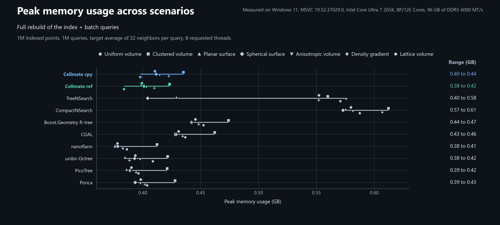

<!-- BEGIN BENCHMARK MEASUREMENTS -->
<details>
<summary>Measurements (70 rows)</summary>

Measured on Windows 11, MSVC 19.52.37029.0, Intel Core Ultra 7 265K, 8P/12E Cores, 96 GB of DDR5 6000 MT/s  
1M indexed points, 1M queries, target average of 32 neighbors per query, 8 requested threads

| Library | Scenario | Peak memory (GB) | Status | Note |
| --- | --- | ---: | --- | --- |
| cellmate `cpy` | Uniform volume | 0.41 | OK |  |
| cellmate `cpy` | Clustered volume | 0.44 | OK |  |
| cellmate `cpy` | Planar surface | 0.41 | OK |  |
| cellmate `cpy` | Spherical surface | 0.41 | OK |  |
| cellmate `cpy` | Anisotropic volume | 0.41 | OK |  |
| cellmate `cpy` | Density gradient | 0.42 | OK |  |
| cellmate `cpy` | Lattice volume | 0.40 | OK |  |
| cellmate `ref` | Uniform volume | 0.40 | OK |  |
| cellmate `ref` | Clustered volume | 0.42 | OK |  |
| cellmate `ref` | Planar surface | 0.40 | OK |  |
| cellmate `ref` | Spherical surface | 0.40 | OK |  |
| cellmate `ref` | Anisotropic volume | 0.40 | OK |  |
| cellmate `ref` | Density gradient | 0.41 | OK |  |
| cellmate `ref` | Lattice volume | 0.38 | OK |  |
| TreeNSearch | Uniform volume | 0.55 | OK |  |
| TreeNSearch | Clustered volume | 0.56 | OK |  |
| TreeNSearch | Planar surface | 0.43 | OK |  |
| TreeNSearch | Spherical surface | 0.40 | OK |  |
| TreeNSearch | Anisotropic volume | 0.58 | OK |  |
| TreeNSearch | Density gradient | 0.55 | OK |  |
| TreeNSearch | Lattice volume | 0.57 | OK |  |
| CompactNSearch | Uniform volume | 0.58 | OK |  |
| CompactNSearch | Clustered volume | 0.61 | OK |  |
| CompactNSearch | Planar surface | 0.58 | OK |  |
| CompactNSearch | Spherical surface | 0.57 | OK |  |
| CompactNSearch | Anisotropic volume | 0.58 | OK |  |
| CompactNSearch | Density gradient | 0.61 | OK |  |
| CompactNSearch | Lattice volume | 0.59 | OK |  |
| Boost.Geometry R-tree | Uniform volume | 0.45 | OK |  |
| Boost.Geometry R-tree | Clustered volume | 0.47 | OK |  |
| Boost.Geometry R-tree | Planar surface | 0.44 | OK |  |
| Boost.Geometry R-tree | Spherical surface | 0.44 | OK |  |
| Boost.Geometry R-tree | Anisotropic volume | 0.44 | OK |  |
| Boost.Geometry R-tree | Density gradient | 0.45 | OK |  |
| Boost.Geometry R-tree | Lattice volume | 0.45 | OK |  |
| CGAL | Uniform volume | 0.43 | OK |  |
| CGAL | Clustered volume | 0.46 | OK |  |
| CGAL | Planar surface | 0.43 | OK |  |
| CGAL | Spherical surface | 0.43 | OK |  |
| CGAL | Anisotropic volume | 0.43 | OK |  |
| CGAL | Density gradient | 0.43 | OK |  |
| CGAL | Lattice volume | 0.44 | OK |  |
| nanoflann | Uniform volume | 0.38 | OK |  |
| nanoflann | Clustered volume | 0.41 | OK |  |
| nanoflann | Planar surface | 0.38 | OK |  |
| nanoflann | Spherical surface | 0.38 | OK |  |
| nanoflann | Anisotropic volume | 0.38 | OK |  |
| nanoflann | Density gradient | 0.38 | OK |  |
| nanoflann | Lattice volume | 0.39 | OK |  |
| unibn Octree | Uniform volume | 0.39 | OK |  |
| unibn Octree | Clustered volume | 0.42 | OK |  |
| unibn Octree | Planar surface | 0.38 | OK |  |
| unibn Octree | Spherical surface | 0.39 | OK |  |
| unibn Octree | Anisotropic volume | 0.40 | OK |  |
| unibn Octree | Density gradient | 0.39 | OK |  |
| unibn Octree | Lattice volume | 0.41 | OK |  |
| PicoTree | Uniform volume | 0.39 | OK |  |
| PicoTree | Clustered volume | 0.42 | OK |  |
| PicoTree | Planar surface | 0.39 | OK |  |
| PicoTree | Spherical surface | 0.39 | OK |  |
| PicoTree | Anisotropic volume | 0.39 | OK |  |
| PicoTree | Density gradient | 0.39 | OK |  |
| PicoTree | Lattice volume | 0.40 | OK |  |
| Ponca | Uniform volume | 0.40 | OK |  |
| Ponca | Clustered volume | 0.43 | OK |  |
| Ponca | Planar surface | 0.39 | OK |  |
| Ponca | Spherical surface | 0.39 | OK |  |
| Ponca | Anisotropic volume | 0.40 | OK |  |
| Ponca | Density gradient | 0.40 | OK |  |
| Ponca | Lattice volume | 0.40 | OK |  |

</details>
<!-- END BENCHMARK MEASUREMENTS -->

## Installation

The library is header-only. Copy `include/cellmate/` into your project, add its parent directory to the include path, and include `cellmate/neighbor_search.hpp`.

Or use CMake, from a subdirectory:
```cmake
add_subdirectory(<path/to/cellmate>)
target_link_libraries(<your_project_name> cellmate::cellmate)
```

Or fetched at configure time:

```cmake
include(FetchContent)
FetchContent_Declare(cellmate GIT_REPOSITORY https://github.com/FelixFrenchFry/cellmate.git GIT_TAG main)
FetchContent_MakeAvailable(cellmate)
target_link_libraries(your_project_name cellmate::cellmate)
```

The target only adds the include path, C++14 and the selected backend. It adds no architecture or floating-point flags. To use AVX2, compile with `-mavx2` (GCC/Clang) or `/arch:AVX2` (MSVC). To use OpenMP, configure with `-DCELLMATE_ENABLE_OPENMP=ON`.

CI runs tests on Linux and Windows with GCC, Clang, and MSVC. AVX-512 builds are compile-checked only. See the [CI workflow](.github/workflows/tests.yml) for the full settings matrix.

## Limitations

* fp32 positions only (TODO: more dtypes)
* no k-nearest neighbors query (TODO: implement)
* 2^32 - 1 points limit
* 2^21 cells along each axis limit

## References

* [BGT20] S. Band, C. Gissler and M. Teschner, 2020. "Compressed Neighbour Lists for SPH", Computer Graphics Forum 39, 1, 531-542.
* [IABT11] M. Ihmsen, N. Akinci, M. Becker and M. Teschner, 2011. "A Parallel SPH Implementation on Multi-Core CPUs", Computer Graphics Forum 30, 1, 99-112.
* [Mor66] G. M. Morton, 1966. "A Computer Oriented Geodetic Data Base and a New Technique in File Sequencing", Technical report, IBM Ltd., Ottawa.
